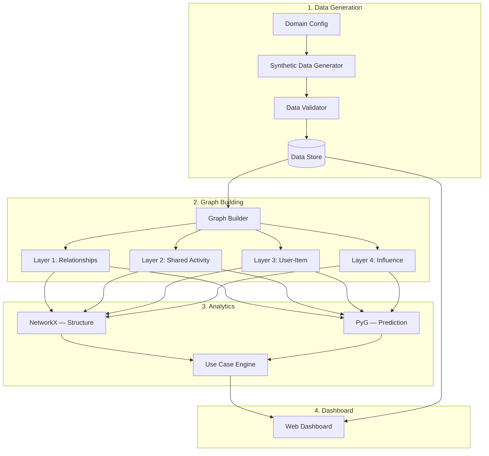
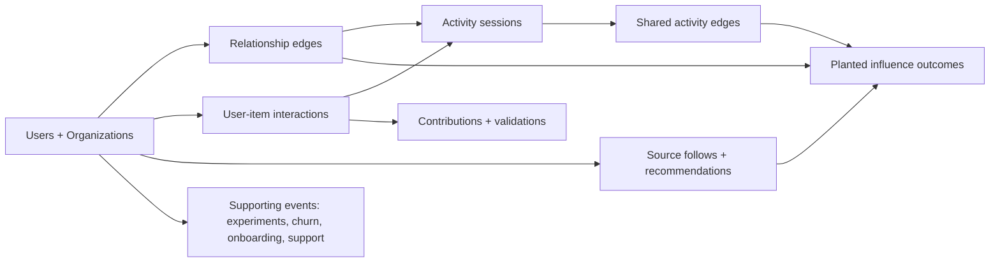
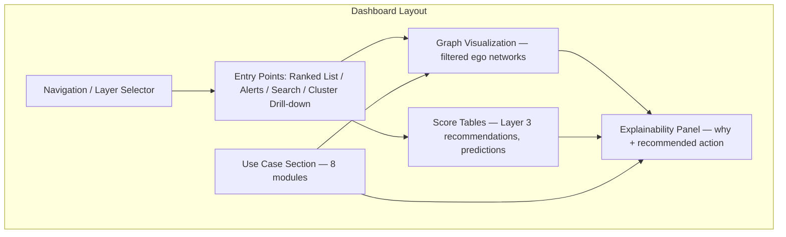
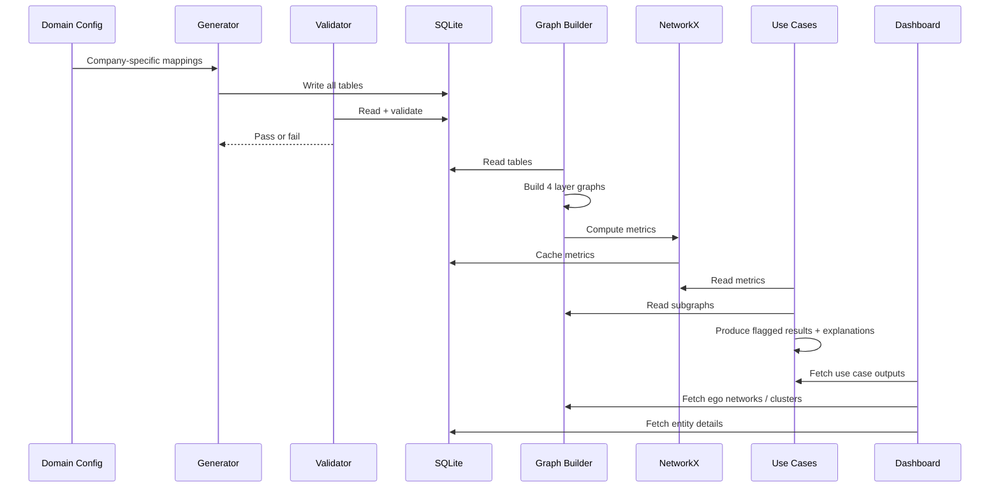

# Architecture — Network Graph Intelligence Project

This document turns `context.md` into a build plan. Each section has a short technical description, then a **In plain English** block that explains what it means without jargon.

---

## What we are building

A working prototype that:
1. Creates realistic fake (synthetic) user and relationship data
2. Builds four types of network graphs from that data
3. Runs graph analysis and predictions on those graphs
4. Shows the results in a dashboard that a product manager can actually use

**In plain English:** We are not writing a theory paper. We are building a demo tool that shows how connections between users, products, and activities should change product decisions — like who to roll a feature out to first, or whether an A/B test is invalid because test users talk to control users.

---

## Big picture



**In plain English:** Fake data gets created and checked. That data gets turned into four graph views. Two analysis engines work on those graphs — one explains structure, one predicts outcomes. A use-case layer turns analysis into specific product decisions. The dashboard shows everything in a readable way.

---

## System layers

The system has four main layers. Each layer has one job.

| Layer | Job | From context.md? |
|---|---|---|
| **Data Generation** | Create realistic synthetic data with planted influence rules | Yes |
| **Graph Building** | Turn tables into NetworkX/PyG graph objects for all 4 layers | Yes (implied) |
| **Analytics** | Run structural analysis (NetworkX) and predictions (PyG) | Yes |
| **Dashboard** | Let PMs explore graphs, alerts, and use-case outputs | Yes |

**In plain English:** Think of it like a factory line. First we make the raw material (data). Then we shape it into graphs. Then we analyze it. Then we show the results to humans.

---

## Component 1 — Domain configuration

**What it does:** Maps generic concepts (users, items, organizations, activities, sources) to company-specific names and rules.

**In plain English:** This is the "adapter" that lets the same system work for a gaming company, a SaaS company, or any other product. Instead of hard-coding "games" and "co-play," the config says what your company calls those things.

**Example mappings:**

| Generic concept | Gaming example | SaaS example |
|---|---|---|
| Item | Game | Feature / document |
| Shared activity | Co-play session | Shared project / meeting |
| Trusted source | Curator | Internal champion / expert |
| Organization | Studio / publisher | Company / workspace |

> **Added decision (not in context.md):** A single `domain_config.yaml` (or similar) file at the project root to hold these mappings.
>
> **Why:** Context says the domain model is configurable but does not say how. A config file keeps the rest of the code generic and makes it easy to swap company examples without rewriting logic.

---

## Component 1b — Environment configuration (`.env`)

**What it does:** Loads runtime paths, dashboard host/port, and generator settings from `.env`. Non-secret defaults live in `.env.example`.

**In plain English:** `domain_config.yaml` says what a "game" or "feature" is called. `.env` holds local runtime settings — database path, data folders, dashboard port, random seed. No API keys.

| Variable group | Purpose |
|---|---|
| `DATABASE_PATH`, `DATA_DIR`, … | Local file paths |
| `GENERATOR_SEED`, `SCALE_MODE` | Synthetic data generation |
| `DASH_HOST`, `DASH_PORT` | Dashboard bind address |

**This project uses no external APIs.**

- Load env via `config/env.py` at every entry point
- Run `scripts/check_env.py` in Phase 0 and Phase 1G

> **Added decision:** `.env` + `.env.example` + `config/env.py` + `scripts/check_env.py`.
>
> **Why:** Central place for local runtime config. No secrets needed.

---

## Component 2 — Synthetic data generator

**What it does:** Creates all tables defined in `context.md` — users, items, relationships, sessions, interactions, contributions, experiments, churn events, etc. — following the scale targets and generation rules.

**Inputs:**
- Domain config
- Scale parameters (~10k users, ~1k items, etc.)
- Planted influence rules (5 families)

**Outputs:**
- All entity and event tables written to the data store
- `planted_influence_rules` stored separately (not fed to models)

**Generation order (dependency-safe):**



**In plain English:** We build the fake world in the right order so nothing breaks logic — you can't review a game you haven't bought, and you can't co-play with someone before you've both joined. Influence effects are baked into the data on purpose so we can later test whether our models can detect them.

**Key rules carried from context.md:**
- Power-law skew (a few hubs, many regular users)
- 70–80% of activity sessions come from existing relationships
- Hidden activity propensity drives correlated behavior
- Five planted influence families share one rule engine
- Timestamps must respect causal order

---

## Component 3 — Data validator

**What it does:** Runs checks after generation to catch impossible data.

**Checks include:**
- No event before a user's join date
- No relationship before both users exist
- No contribution before the related item interaction
- No shared activity before all participants joined
- Planted rules recorded and separable from model inputs
- Distribution sanity (not flat/uniform — hubs exist, communities form)

**In plain English:** This is a quality gate. It makes sure the fake data is realistic enough that graph analysis will actually produce meaningful results, not garbage.

> **Added decision (not in context.md):** A standalone validation script that runs after every generation and prints a pass/fail report.
>
> **Why:** Context says to run a validation pass but does not describe it as a separate component. Making it explicit keeps bad data from silently breaking downstream analysis.

---

## Component 4 — Graph builder

**What it does:** Reads tables from the data store and builds in-memory graph objects for each layer.

**Four graph types:**

| Graph | Nodes | Edges | Built from |
|---|---|---|---|
| **Layer 1 — Relationships** | Users | Typed relationship edges | `relationship_edges` |
| **Layer 2 — Shared activity** | Users | Weighted co-activity edges | Derived `shared_activity_edges` |
| **Layer 3 — User–item** | Users + Items | Interaction edges (bipartite) | `user_item_interactions` |
| **Layer 4 — Influence** | Users + Sources + Contributions | Validation, follow, recommendation edges | Layer 4 tables |

**Derived projections (computed, not always stored):**
- Item–item similarity graph (Layer 3)
- User–user taste graph (Layer 3)
- Ego networks (local neighborhood around one node)

**In plain English:** The database holds flat tables (rows and columns). The graph builder connects the dots — "user A knows user B," "user C and D played together 40 times," "user E owns item F." These connections are what NetworkX and PyG actually work on.

> **Added decision (not in context.md):** Graphs are built in memory (NetworkX objects) and optionally cached to disk after first build.
>
> **Why:** Context defines the schema but not the runtime graph format. NetworkX is the natural in-memory format since it is already our analysis library. Caching avoids rebuilding graphs on every dashboard page load.

---

## Component 5 — NetworkX analytics (descriptive layer)

**What it does:** Answers "what does the graph look like right now?" — no machine learning, just structural math.

**Capabilities:**

| Capability | Used for | Layers |
|---|---|---|
| Betweenness centrality | Bridge users, support blast radius | 1, 2, 4 |
| Eigenvector centrality | Important/influential users, rollout sequencing | 1, 2, 4 |
| Community detection (Louvain) | Cluster/team discovery, fraud rings | All |
| Edge weight / frequency | Connection strength, recommendations | 2, 3 |
| Shortest path / connectivity | Isolation, churn cascade risk | 1, 2 |
| Density / reciprocity | Fraud/fake-account detection | 1, 4 |
| Co-occurrence projection | "People who use X also use Y" | 3 |

**In plain English:** This is the "explain why" engine. When the dashboard says "user X is important," NetworkX provides the reason — they bridge three teams, or they're connected to other influential people, or they sit between two clusters. A PM can look at this and understand it without knowing any math.

**Output format:** Each metric is stored as a score per node or cluster, with metadata about which graph layer and edge type produced it.

---

## Component 6 — PyG analytics (predictive layer)

**What it does:** Answers "what is likely to happen next?" — uses graph neural networks trained on the synthetic data.

**Capabilities:**

| Capability | Used for | Phase |
|---|---|---|
| Link prediction | New connections, item adoption, cold-start recommendations | Phase 2 |
| Node classification | Churn risk, adoption likelihood, behavior trajectory | Phase 2 |
| Influence propagation (GNN) | Cascade simulation after churn/adoption/participation | Phase 2 |

**In plain English:** NetworkX tells you what the graph looks like today. PyG guesses what might happen tomorrow — "if this champion leaves, these 12 users are at risk" or "this user is likely to adopt the new feature because their activity group already did." This is the forward-looking part.

**Important constraint from context.md:** PyG models must NOT receive `planted_influence_rules` as input. They must recover influence patterns from graph structure and behavior alone. This is how we validate that the mechanism works.

**Combined adoption model:** Layer 3 items (cold-start, bundles, adoption prediction) and Layer 4 items (source/contributor influence) feed one combined model rather than separate competing models.

> **Added decision (not in context.md):** PyG work is explicitly deferred to Phase 2. Phase 1 delivers the full NetworkX layer + dashboard with all 8 use cases using structural metrics only.
>
> **Why:** Context recommends building NetworkX first and adding PyG once the graph is validated. Making this a hard phase boundary keeps Phase 1 scope achievable and demo-ready.

---

## Component 7 — Use case engine

**What it does:** Takes raw metrics from NetworkX (and later PyG) and turns them into the 8 product decisions defined in context.md.

**Each use case is a small, self-contained module:**

| # | Use case | Primary metric(s) | Toggle: most/least important? |
|---|---|---|---|
| 1 | A/B contamination | Connection strength + influence strength | Yes |
| 2 | Champion churn risk | Eigenvector centrality + activity signal | Yes |
| 3 | Feature rollout sequencing | Eigenvector centrality | Yes |
| 4 | User research prioritization | Community-validated influence | Yes |
| 5 | Support escalation | Betweenness centrality | Yes |
| 6 | Onboarding flow | Binary: has existing connection? | No (exempt) |
| 7 | Feature discovery gap | Isolation/distance from exposure | No (exempt) |
| 8 | Fraud ring detection | Density + reciprocity pattern | No (exempt) |

**Each use case module produces:**
- A ranked or flagged list of nodes/clusters
- A plain-language explanation of why each was flagged
- A recommended product action
- Links to the relevant ego-network or cluster view in the dashboard

**In plain English:** This is the "so what?" layer. Raw centrality scores are meaningless to a PM on their own. The use case engine translates "this user has eigenvector centrality 0.82" into "this user is a super-connector — if they leave, 3 clusters lose their bridge."

> **Added decision (not in context.md):** Each use case is implemented as a separate Python module with a shared interface (input: graph + metrics, output: flagged results + explanation).
>
> **Why:** Context lists 8 use cases with different metrics and toggle rules. A modular design lets us build and test them one at a time without breaking others.

---

## Component 8 — Dashboard

**What it does:** The front-end that product managers interact with. Shows graphs, lists, alerts, and use-case outputs.

### Dashboard sections



**In plain English:** The dashboard has two main areas. The top area lets you explore the graph — search for a user, browse ranked lists, or drill into clusters. The bottom area shows the 8 use-case outputs — contamination alerts, churn risks, rollout suggestions, etc. Every result comes with a plain-language explanation and a suggested action.

### Graph rendering rules (from context.md)
- Never render the full 10k-node graph
- Always show filtered views: ego networks, cluster bubbles, or subgraphs
- Layer 3 outputs (recommendations, similarity scores) appear as tables below the graph, not forced into a node-link diagram

### Four entry paths (from context.md)
1. **Ranked list** — sort by centrality, click to open ego network
2. **Alerts** — flagged nodes with graph attached
3. **Search** — find a specific user/item/org/source
4. **Cluster drill-down** — community bubbles → cluster → top nodes → individual ego network

### Layer selection (from context.md)
- View any single layer (1, 2, 3, or 4)
- View all layers combined
- Pick a custom subset

### Linked views (Dash callbacks)

The dashboard has many panels that must update together. Dash handles this with callbacks:

| User action | What updates |
|---|---|
| Click a row in the ranked list | Graph view, explainability panel, and node details |
| Select a layer or layer subset | Graph view and available metrics |
| Click a node in the graph | Explainability panel and related use-case flags |
| Switch use case or most/least-important toggle | Flagged list and attached subgraph |
| Search for a user/item/org/source | Graph jumps to that node's ego network |

**In plain English:** When a PM clicks something in one part of the screen, the other parts react automatically — like a real app, not a stack of separate pages.

> **Added decision (not in context.md):** Dashboard built with **Plotly Dash** (Python web framework with callback-based linked views).
>
> **Why:** Context specifies a dashboard but not a framework. This project needs multiple panels that stay in sync — ranked list, graph, use-case output, and explainability panel. Dash is built for that pattern. It stays fully in Python while giving more layout control and cleaner interactivity than a page-by-page prototype tool.

> **Added decision (not in context.md):** Graph visualization uses **dash-cytoscape** for ego-network and cluster views.
>
> **Why:** Context requires interactive filtered graph views. Cytoscape is a first-class Dash component: PMs can click nodes, layouts work on small subgraphs (50–200 nodes), and node clicks can trigger callbacks that update the explanation panel and use-case section. Force-directed layouts run on filtered views only, never the full 10k-node graph.

> **Added decision (not in context.md):** Tables and score lists use **dash-ag-grid** or **Dash DataTable**; charts use **Plotly** where needed (e.g. cluster summaries, metric distributions).
>
> **Why:** Layer 3 outputs and ranked lists are table-heavy. Dash-native table components support sorting, filtering, and row-click callbacks that tie into the graph and explainability panels.

---

## Component 9 — Explainability layer

**What it does:** Wraps every alert and prediction with the context a PM needs to trust and act on it.

**Every result includes:**

| Field | Example |
|---|---|
| Local network | Ego network of the flagged user (graph snippet) |
| Metric that triggered it | "Eigenvector centrality: 0.82 (top 2%)" |
| Edge types involved | "Connected via 12 shared activity sessions + 3 direct relationships" |
| Plain-language explanation | "This user bridges the Engineering and Sales clusters" |
| Recommended action | "Prioritize for retention outreach before Q3 renewal" |
| Confidence (Phase 2) | "Prediction confidence: 78%" |

**In plain English:** No black-box scores. Every flag comes with a "here's why" and a "here's what to do." This is a core design principle, not an afterthought.

From context.md — no additions here.

---

## Data store

**What it holds:** All entity tables, event tables, derived projections, computed metrics, and planted influence rules.

> **Added decision (not in context.md):** Use **SQLite** as the data store for the prototype.
>
> **Why:** Context defines the schema but not the storage technology. SQLite requires zero setup, handles the target scale (~10k users, ~500k rows) easily, and keeps the prototype self-contained in a single file. Can migrate to PostgreSQL later if needed.

**Storage layout:**

```
data/
├── synthetic.db          # All entity + event tables
├── graphs/               # Cached NetworkX graph pickles (optional)
├── metrics/              # Precomputed centrality scores, community assignments
└── models/               # Trained PyG model weights (Phase 2)
```

> **Added decision (not in context.md):** Precompute and cache centrality scores and community assignments after graph build, rather than recalculating on every dashboard load.
>
> **Why:** Betweenness centrality on 10k nodes with 200k edges is slow to compute live. Precomputing once and serving cached results makes the dashboard responsive. Context implies a working dashboard, not one that hangs on load.

---

## Project folder structure

> **Added decision (not in context.md):** The following folder layout. Context does not specify code organization.
>
> **Why:** A clear folder structure makes it obvious where each component lives and lets us build layer by layer without confusion.

```
network-graph/
├── context.md
├── architecture.md
├── domain_config.yaml        # Company/domain mappings
├── .env.example              # Env template (commit this)
├── .env                      # Local secrets (gitignored)
├── requirements.txt
│
├── config/
│   ├── __init__.py
│   └── env.py                # load_env(), get(), require()
│
├── scripts/
│   ├── check_env.py
│   ├── check_cache_freshness.py
│   └── perf_smoke.py
│
├── data/                     # Generated data + caches (gitignored)
│
├── generator/                # Component 2: Synthetic data generation
│   ├── __init__.py
│   ├── users.py
│   ├── relationships.py
│   ├── activities.py
│   ├── interactions.py
│   ├── influence.py          # Planted rule engine
│   ├── supporting_events.py  # Experiments, churn, onboarding, support
│   └── run_generator.py      # Orchestrates full generation
│
├── validator/                # Component 3: Data validation
│   ├── __init__.py
│   └── run_validation.py
│
├── graphs/                   # Component 4: Graph building
│   ├── __init__.py
│   ├── builder.py            # Builds all 4 layer graphs
│   └── projections.py        # Item-item, user-user projections
│
├── analytics/                # Components 5 + 6: Analysis engines
│   ├── __init__.py
│   ├── networkx_metrics.py   # Centrality, communities, paths
│   ├── pyg_models.py         # GNN training + inference (Phase 2)
│   └── combined_adoption.py  # Unified adoption prediction model
│
├── use_cases/                # Component 7: Use case modules
│   ├── __init__.py
│   ├── base.py               # Shared interface
│   ├── ab_contamination.py
│   ├── champion_churn.py
│   ├── rollout_sequencing.py
│   ├── research_priority.py
│   ├── support_escalation.py
│   ├── onboarding_flow.py
│   ├── discovery_gap.py
│   └── fraud_detection.py
│
├── dashboard/                # Component 8: Dash dashboard
│   ├── __init__.py
│   ├── app.py                # Dash app instance + run entry point
│   ├── layout.py             # Page layout and component tree
│   ├── callbacks.py          # Linked-view callbacks (list → graph → explanation)
│   ├── graph_views.py        # Cytoscape ego-network and cluster components
│   ├── entry_points.py       # Ranked list, search, alerts, drill-down components
│   ├── use_case_views.py     # Use case section components
│   └── explainability.py     # Explanation panel component
│
└── tests/
    ├── test_generator.py
    ├── test_validator.py
    ├── test_graphs.py
    └── test_use_cases.py
```

---

## Build phases

### Phase 1 — Foundation (NetworkX + Dashboard)

**Goal:** End-to-end working prototype with synthetic data, all 4 graph layers, all 8 use cases (structural metrics only), and a readable dashboard.

| Step | What gets built | Done when |
|---|---|---|
| 1.1 | Domain config + project scaffolding | Folder structure, config file, requirements |
| 1.2 | Synthetic data generator | All tables populated at target scale |
| 1.3 | Data validator | Pass/fail report on generated data |
| 1.4 | Graph builder | All 4 layer graphs build without errors |
| 1.5 | NetworkX metrics | Centrality, communities, paths computed and cached |
| 1.6 | Use case engine (all 8) | Each use case produces flagged results + explanations |
| 1.7 | Dashboard | All entry paths, layer selection, use case section working |
| 1.8 | Explainability layer | Every result shows why + recommended action |

**In plain English:** Phase 1 gives you a complete demo. A PM can open the dashboard, explore the graph, and see all 8 use-case outputs with explanations. No machine learning yet — just structural analysis, which is already powerful.

### Phase 2 — Prediction (PyG)

**Goal:** Add forward-looking predictions and influence recovery on top of the validated Phase 1 foundation.

| Step | What gets built | Done when |
|---|---|---|
| 2.1 | PyG graph conversion | NetworkX graphs export to PyG Data objects |
| 2.2 | Combined adoption model | Single model using social + activity + item + influence signals |
| 2.3 | Churn cascade simulation | GNN-based propagation after champion departure |
| 2.4 | Influence recovery validation | Models recover planted rules without being told them |
| 2.5 | Dashboard integration | Predictions and confidence scores appear in explainability panel |

**In plain English:** Phase 2 adds the "what will happen" layer. The dashboard goes from "this user is important" to "if this user leaves, these 12 others are likely to follow."

From context.md — build sequence recommendation. Phase split is an architectural formalization of that recommendation.

---

## How data flows through the system



**In plain English:** Config tells the generator what to create. Generator writes data. Validator checks it. Graph builder reads data and builds graphs. NetworkX computes scores. Use cases turn scores into decisions. Dashboard shows everything to the PM.

---

## Summary of flagged additions

These decisions were not in `context.md`. Review and change any you disagree with.

| # | Decision | Why it was added |
|---|---|---|
| 1 | `domain_config.yaml` for company-specific mappings | Context says configurable but doesn't specify how |
| 2 | Standalone validation script with pass/fail report | Context mentions validation but not as a named component |
| 3 | In-memory NetworkX graphs with optional disk cache | Context defines schema, not runtime graph format |
| 4 | Hard Phase 1 / Phase 2 split (NetworkX first, PyG later) | Context recommends this sequence; architecture formalizes it |
| 5 | Each use case as a separate Python module | Keeps 8 use cases independently buildable and testable |
| 6 | Plotly Dash for the dashboard | Context says "dashboard" but not which framework; Dash fits multi-panel linked views (list → graph → explanation) |
| 7 | dash-cytoscape for ego-network graph rendering | Context requires interactive filtered graph views; node clicks drive callbacks to other panels |
| 7b | dash-ag-grid / Dash DataTable + Plotly charts | Table-heavy outputs (ranked lists, Layer 3 scores) need sortable, clickable components |
| 8 | SQLite as data store | Context defines schema, not storage; SQLite is zero-setup at prototype scale |
| 9 | Precomputed metric caching | Betweenness on 10k nodes is too slow for live dashboard queries |
| 10 | Project folder structure | Context has no code organization; needed for build clarity |

---

## What this architecture does NOT cover (yet)

These are intentionally left open for later decisions:

- Exact weighting for champion churn risk (eigenvector + activity signal)
- Exact implementation of the combined adoption model (single model vs. pipeline)
- Whether graph edges are directed or undirected per relationship type
- Whether projections (item-item, shared-activity edges) are stored or computed on the fly
- Column-level schema detail (foreign keys, indexes)
- Authentication or multi-user access (not needed for a prototype demo)

**In plain English:** The architecture covers the big pieces and how they connect. Fine-grained implementation choices inside each component can be decided when we start building that component.
