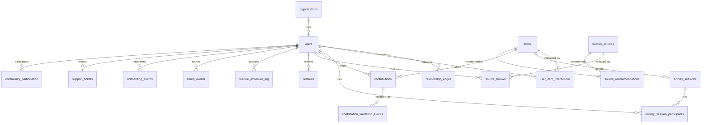

# Data Schema — Network Graph Intelligence Project

Column-level schema for SQLite (`data/synthetic.db`). Derived/runtime artifacts (graph pickles, metric files) documented in §6–§7.

**Conventions**
- PK: `INTEGER PRIMARY KEY` (SQLite rowid alias) or natural composite key where noted
- Timestamps: `TEXT ISO8601` (`YYYY-MM-DDTHH:MM:SS`) or `DATE` for day-granularity events
- IDs: `TEXT` prefixed slugs (`usr_`, `org_`, `itm_`, etc.) or `INTEGER` — pick one at implementation; examples use `TEXT`
- `NOT NULL` unless marked optional
- `_gen_*` columns: generator-internal; **must not** be exposed as PyG model features
- FK actions: `ON DELETE RESTRICT` default; cascade only on participant join tables

---

## 1. Entity-relationship overview



---

## 2. Core entity tables

### 2.1 `organizations`

| Column | Type | Constraints | Notes |
|---|---|---|---|
| `organization_id` | TEXT | PK | |
| `name` | TEXT | NOT NULL | |
| `org_type` | TEXT | NOT NULL | e.g. `company`, `workspace`, `studio`, `publisher` |
| `parent_organization_id` | TEXT | FK → `organizations.organization_id`, NULL | Optional hierarchy |
| `created_at` | TEXT | NOT NULL | |

**Indexes:** `idx_organizations_parent` ON (`parent_organization_id`)

---

### 2.2 `users`

| Column | Type | Constraints | Notes |
|---|---|---|---|
| `user_id` | TEXT | PK | |
| `organization_id` | TEXT | FK → `organizations.organization_id`, NOT NULL | |
| `display_name` | TEXT | NOT NULL | Dashboard search |
| `join_date` | TEXT | NOT NULL | DATE or TIMESTAMP |
| `last_active_date` | TEXT | NOT NULL | Used for onboarding active-connection check |
| `activity_propensity` | REAL | NOT NULL | `_gen_*` — drives degree, contributions, etc. |
| `taste_cluster_id` | INTEGER | NOT NULL | `_gen_*` — item/session affinity |
| `is_active` | INTEGER | NOT NULL DEFAULT 1 | Boolean 0/1; derived from `last_active_date` + threshold |

**Indexes**
- `idx_users_org` ON (`organization_id`)
- `idx_users_join_date` ON (`join_date`)
- `idx_users_last_active` ON (`last_active_date`)
- `idx_users_display_name` ON (`display_name`)

**Active connection rule (onboarding use case):** connection to user `u2` is *active* iff `u2.is_active = 1` AND `u2.last_active_date >= reference_date - N days` (N configurable; default 90).

---

### 2.3 `items`

| Column | Type | Constraints | Notes |
|---|---|---|---|
| `item_id` | TEXT | PK | Product, game, feature, content unit |
| `title` | TEXT | NOT NULL | |
| `provider` | TEXT | NULL | Publisher, vendor, internal team |
| `category_tags` | TEXT | NULL | JSON array or comma-separated |
| `release_date` | TEXT | NOT NULL | |
| `popularity_score` | REAL | NOT NULL | `_gen_*` — lognormal/power-law draw |
| `taste_cluster_id` | INTEGER | NOT NULL | `_gen_*` — affinity cluster |

**Indexes**
- `idx_items_release_date` ON (`release_date`)
- `idx_items_provider` ON (`provider`)

---

### 2.4 `trusted_sources`

| Column | Type | Constraints | Notes |
|---|---|---|---|
| `source_id` | TEXT | PK | Curator, expert, creator, champion |
| `name` | TEXT | NOT NULL | |
| `source_type` | TEXT | NOT NULL | e.g. `curator`, `expert`, `creator`, `internal` |
| `specialization_cluster_id` | INTEGER | NOT NULL | `_gen_*` — recommendation alignment |
| `created_at` | TEXT | NOT NULL | |
| `follower_count_stored` | INTEGER | NULL | Optional denormalized; prefer derived from `source_follows` |

**Indexes:** `idx_sources_type` ON (`source_type`)

---

## 3. Layer 1 — User relationship graph

### 3.1 `relationship_edges`

| Column | Type | Constraints | Notes |
|---|---|---|---|
| `edge_id` | INTEGER | PK AUTOINCREMENT | Surrogate PK |
| `user_id_a` | TEXT | FK → `users.user_id`, NOT NULL | |
| `user_id_b` | TEXT | FK → `users.user_id`, NOT NULL | |
| `relationship_type` | TEXT | NOT NULL | See enum below |
| `connection_date` | TEXT | NOT NULL | ≥ both users' `join_date` |
| `organization_scope` | TEXT | NULL | `within_org`, `cross_org` — denormalized for queries |

**Directionality by type**

| `relationship_type` | Storage | Graph build |
|---|---|---|
| `friend` | Undirected; enforce `user_id_a < user_id_b` | Single undirected edge |
| `follow` | Directed: `user_id_a` → `user_id_b` | Directed edge |
| `collaborate` | Undirected canonical | Undirected edge |
| `member_of` | Directed: user → group/user | Directed edge |

**Constraints**
- `CHECK (user_id_a != user_id_b)`
- Unique undirected: `UNIQUE (user_id_a, user_id_b, relationship_type)` where canonical order enforced for undirected types
- Unique directed: `UNIQUE (user_id_a, user_id_b, relationship_type)` without ordering

**Indexes**
- `idx_rel_edges_a` ON (`user_id_a`)
- `idx_rel_edges_b` ON (`user_id_b`)
- `idx_rel_edges_type` ON (`relationship_type`)
- `idx_rel_edges_date` ON (`connection_date`)

---

### 3.2 `referrals`

Ground-truth metadata only; not inferred from graph structure.

| Column | Type | Constraints | Notes |
|---|---|---|---|
| `referral_id` | INTEGER | PK AUTOINCREMENT | |
| `referred_user_id` | TEXT | FK → `users.user_id`, UNIQUE, NOT NULL | One referrer per referred user |
| `referrer_user_id` | TEXT | FK → `users.user_id`, NOT NULL | |
| `referral_source` | TEXT | NOT NULL | `internal`, `external`, `campaign`, etc. |
| `referral_timestamp` | TEXT | NOT NULL | ≥ referrer.join_date; ≤ referred.join_date |

**Indexes**
- `idx_referrals_referrer` ON (`referrer_user_id`)
- `idx_referrals_timestamp` ON (`referral_timestamp`)

---

## 4. Layer 2 — Shared activity graph

### 4.1 `activity_sessions`

| Column | Type | Constraints | Notes |
|---|---|---|---|
| `session_id` | TEXT | PK | |
| `item_id` | TEXT | FK → `items.item_id`, NULL | Nullable for non-item activities |
| `activity_type` | TEXT | NOT NULL | e.g. `coplay`, `collab`, `meeting`, `transaction` |
| `session_timestamp` | TEXT | NOT NULL | |
| `duration_seconds` | INTEGER | NOT NULL | ≥ 0 |
| `organization_scope` | TEXT | NULL | `within_org`, `cross_org` |

**Indexes**
- `idx_sessions_item` ON (`item_id`)
- `idx_sessions_timestamp` ON (`session_timestamp`)
- `idx_sessions_type` ON (`activity_type`)

---

### 4.2 `activity_session_participants`

| Column | Type | Constraints | Notes |
|---|---|---|---|
| `session_id` | TEXT | FK → `activity_sessions.session_id`, NOT NULL | |
| `user_id` | TEXT | FK → `users.user_id`, NOT NULL | |
| `role` | TEXT | NULL | e.g. `host`, `participant` |

**PK:** `(session_id, user_id)`

**Indexes:** `idx_session_participants_user` ON (`user_id`)

**Generation constraint:** `session_timestamp` ≥ `join_date` for all participants.

---

### 4.3 `shared_activity_edges` (DERIVED — optional materialized)

**Default:** computed at graph-build time, not stored.

| Column | Type | Notes |
|---|---|---|
| `user_id_a` | TEXT | Canonical: `user_id_a < user_id_b` |
| `user_id_b` | TEXT | |
| `activity_type` | TEXT | |
| `session_count` | INTEGER | Co-participation frequency |
| `total_shared_duration_seconds` | INTEGER | Sum of session durations where both participated |
| `last_session_timestamp` | TEXT | |
| `has_relationship_edge` | INTEGER | Boolean — denormalized flag for Layer 1 vs 2 analysis |

**Aggregation logic**

```sql
-- Pairwise co-participation within session
SELECT LEAST(p1.user_id, p2.user_id) AS user_id_a,
       GREATEST(p1.user_id, p2.user_id) AS user_id_b,
       s.activity_type,
       COUNT(DISTINCT s.session_id) AS session_count,
       SUM(s.duration_seconds) AS total_shared_duration_seconds,
       MAX(s.session_timestamp) AS last_session_timestamp
FROM activity_session_participants p1
JOIN activity_session_participants p2
  ON p1.session_id = p2.session_id AND p1.user_id < p2.user_id
JOIN activity_sessions s ON s.session_id = p1.session_id
GROUP BY 1, 2, 3;
```

**Optional materialization:** `CREATE TABLE shared_activity_edges AS ...` for query performance; rebuild on regeneration.

**Indexes (if materialized):** composite on (`user_id_a`, `user_id_b`, `activity_type`)

---

## 5. Layer 3 — User–item bipartite graph

### 5.1 `user_item_interactions`

| Column | Type | Constraints | Notes |
|---|---|---|---|
| `interaction_id` | INTEGER | PK AUTOINCREMENT | |
| `user_id` | TEXT | FK → `users.user_id`, NOT NULL | |
| `item_id` | TEXT | FK → `items.item_id`, NOT NULL | |
| `interaction_type` | TEXT | NOT NULL | `own`, `use`, `purchase`, `subscribe` |
| `interaction_date` | TEXT | NOT NULL | ≥ user.join_date; ≥ item.release_date |
| `usage_total` | REAL | NOT NULL DEFAULT 0 | Hours, sessions, clicks — domain-specific unit |
| `transaction_value` | REAL | NULL | Optional monetary value |

**Unique:** `(user_id, item_id, interaction_type)` — one row per type per pair; or allow multiples with `interaction_id` only if modeling repeat purchases

**Indexes**
- `idx_uii_user` ON (`user_id`)
- `idx_uii_item` ON (`item_id`)
- `idx_uii_date` ON (`interaction_date`)
- `idx_uii_type` ON (`interaction_type`)

---

### 5.2 `item_item_projection` (DERIVED)

**Computed at graph-build; not stored by default.**

| Column | Type | Notes |
|---|---|---|
| `item_id_a` | TEXT | Canonical: `item_id_a < item_id_b` |
| `item_id_b` | TEXT | |
| `shared_user_count` | INTEGER | Users interacting with both items |
| `jaccard_similarity` | REAL | Optional: \|A∩B\| / \|A∪B\| |

**Threshold:** emit edge only if `shared_user_count >= min_shared_users` (default: 5)

**Indexes (if materialized):** (`item_id_a`, `item_id_b`)

---

### 5.3 `user_user_taste_projection` (DERIVED)

Optional derived table for user taste clustering (Layer 3 item 3).

| Column | Type | Notes |
|---|---|---|
| `user_id_a` | TEXT | Canonical order |
| `user_id_b` | TEXT | |
| `shared_item_count` | INTEGER | |
| `jaccard_similarity` | REAL | |

Same threshold logic as item-item projection.

---

## 6. Layer 4 — Review / influence graph

### 6.1 `contributions`

| Column | Type | Constraints | Notes |
|---|---|---|---|
| `contribution_id` | TEXT | PK | Review, post, rating |
| `user_id` | TEXT | FK → `users.user_id`, NOT NULL | |
| `item_id` | TEXT | FK → `items.item_id`, NULL | Nullable for non-item posts |
| `content` | TEXT | NULL | |
| `rating` | REAL | NULL | e.g. 1–5 |
| `contribution_timestamp` | TEXT | NOT NULL | |
| `quality_score` | REAL | NOT NULL | `_gen_*` — drives validation distribution |

**Constraint:** if `item_id` NOT NULL, require existing `user_item_interactions` row with `interaction_date <= contribution_timestamp`

**Indexes**
- `idx_contributions_user` ON (`user_id`)
- `idx_contributions_item` ON (`item_id`)
- `idx_contributions_timestamp` ON (`contribution_timestamp`)

---

### 6.2 `contribution_validation_events`

| Column | Type | Constraints | Notes |
|---|---|---|---|
| `validation_id` | INTEGER | PK AUTOINCREMENT | |
| `contribution_id` | TEXT | FK → `contributions.contribution_id`, NOT NULL | |
| `voter_user_id` | TEXT | FK → `users.user_id`, NOT NULL | |
| `validation_type` | TEXT | NOT NULL | `helpful`, `upvote`, `endorse`, etc. |
| `validation_timestamp` | TEXT | NOT NULL | |

**Unique:** `(contribution_id, voter_user_id, validation_type)` — one vote type per voter per contribution

**Indexes**
- `idx_validation_contribution` ON (`contribution_id`)
- `idx_validation_voter` ON (`voter_user_id`)

---

### 6.3 `source_follows`

| Column | Type | Constraints | Notes |
|---|---|---|---|
| `user_id` | TEXT | FK → `users.user_id`, NOT NULL | |
| `source_id` | TEXT | FK → `trusted_sources.source_id`, NOT NULL | |
| `follow_date` | TEXT | NOT NULL | |

**PK:** `(user_id, source_id)`

**Indexes:** `idx_source_follows_source` ON (`source_id`)

---

### 6.4 `source_recommendations`

| Column | Type | Constraints | Notes |
|---|---|---|---|
| `recommendation_id` | INTEGER | PK AUTOINCREMENT | |
| `source_id` | TEXT | FK → `trusted_sources.source_id`, NOT NULL | |
| `item_id` | TEXT | FK → `items.item_id`, NOT NULL | |
| `recommendation_date` | TEXT | NOT NULL | ≥ item.release_date |

**Indexes**
- `idx_source_recs_source` ON (`source_id`)
- `idx_source_recs_item` ON (`item_id`)
- `idx_source_recs_date` ON (`recommendation_date`)

---

## 7. Supporting event tables

### 7.1 `community_participation`

| Column | Type | Constraints | Notes |
|---|---|---|---|
| `post_id` | TEXT | PK | |
| `user_id` | TEXT | FK → `users.user_id`, NOT NULL | |
| `post_timestamp` | TEXT | NOT NULL | |
| `engagement_received` | INTEGER | NOT NULL DEFAULT 0 | Replies, likes, etc. |
| `topic_tag` | TEXT | NULL | |

**Indexes:** `idx_community_user` ON (`user_id`), `idx_community_timestamp` ON (`post_timestamp`)

---

### 7.2 `support_tickets`

| Column | Type | Constraints | Notes |
|---|---|---|---|
| `ticket_id` | TEXT | PK | |
| `user_id` | TEXT | FK → `users.user_id`, NOT NULL | |
| `ticket_timestamp` | TEXT | NOT NULL | |
| `severity` | TEXT | NOT NULL | `low`, `medium`, `high`, `critical` |
| `status` | TEXT | NOT NULL | `open`, `in_progress`, `resolved`, `closed` |
| `category` | TEXT | NULL | `bug`, `complaint`, `question` |

**Indexes**
- `idx_tickets_user` ON (`user_id`)
- `idx_tickets_status` ON (`status`)
- `idx_tickets_severity` ON (`severity`)

---

### 7.3 `feature_exposure_log`

| Column | Type | Constraints | Notes |
|---|---|---|---|
| `exposure_id` | INTEGER | PK AUTOINCREMENT | |
| `user_id` | TEXT | FK → `users.user_id`, NOT NULL | |
| `feature_id` | TEXT | NOT NULL | May map to `items.item_id` or standalone feature slug |
| `experiment_id` | TEXT | NOT NULL | |
| `variant` | TEXT | NOT NULL | `control`, `treatment`, or variant label |
| `exposed_flag` | INTEGER | NOT NULL | Boolean 0/1 |
| `exposure_timestamp` | TEXT | NOT NULL | |

**Indexes**
- `idx_exposure_experiment` ON (`experiment_id`, `variant`)
- `idx_exposure_user` ON (`user_id`)
- `idx_exposure_feature` ON (`feature_id`)

**Use cases:** A/B contamination (#1), rollout sequencing (#3), feature discovery gap (#7)

---

### 7.4 `churn_events`

| Column | Type | Constraints | Notes |
|---|---|---|---|
| `user_id` | TEXT | PK, FK → `users.user_id` | One churn record per user |
| `churn_date` | TEXT | NULL | NULL if inactive but not formally churned |
| `last_active_date` | TEXT | NOT NULL | |
| `churn_type` | TEXT | NOT NULL | `explicit`, `implicit_inactivity` |

**Indexes:** `idx_churn_date` ON (`churn_date`)

---

### 7.5 `onboarding_events`

| Column | Type | Constraints | Notes |
|---|---|---|---|
| `onboarding_id` | INTEGER | PK AUTOINCREMENT | |
| `user_id` | TEXT | FK → `users.user_id`, NOT NULL | |
| `onboarding_flow_type` | TEXT | NOT NULL | `guided`, `self_serve` |
| `assigned_timestamp` | TEXT | NOT NULL | |
| `completion_status` | TEXT | NOT NULL | `completed`, `in_progress`, `abandoned` |
| `had_active_connection_at_start` | INTEGER | NOT NULL | Boolean — eval ground truth |

**Indexes:** `idx_onboarding_user` ON (`user_id`)

---

### 7.6 `trust_safety_events`

| Column | Type | Constraints | Notes |
|---|---|---|---|
| `event_id` | INTEGER | PK AUTOINCREMENT | |
| `user_id` | TEXT | FK → `users.user_id`, NOT NULL | |
| `event_type` | TEXT | NOT NULL | `report`, `ban`, `flag`, `warning` |
| `severity` | TEXT | NOT NULL | |
| `event_timestamp` | TEXT | NOT NULL | |

**Indexes:** `idx_trust_user` ON (`user_id`), `idx_trust_type` ON (`event_type`)

---

## 8. Simulation control tables

### 8.1 `planted_influence_rules`

**Must not be joined into PyG feature pipelines.**

| Column | Type | Constraints | Notes |
|---|---|---|---|
| `rule_id` | TEXT | PK | |
| `influence_family` | TEXT | NOT NULL | `adoption`, `participation`, `activity`, `source`, `contributor` |
| `trigger_event` | TEXT | NOT NULL | e.g. `purchase`, `post`, `session_end`, `recommendation_view` |
| `eligible_edge_types` | TEXT | NOT NULL | JSON array: `["relationship","shared_activity","source_follow"]` |
| `effect_boost` | REAL | NOT NULL | Multiplier or additive probability boost |
| `base_probability` | REAL | NOT NULL | |
| `decay_window_days` | INTEGER | NOT NULL | |
| `max_hops` | INTEGER | NOT NULL DEFAULT 1 | Propagation depth |
| `org_constraint` | TEXT | NULL | `same_org`, `any`, NULL |
| `seed` | INTEGER | NOT NULL | Reproducibility |
| `created_at` | TEXT | NOT NULL | |

---

### 8.2 `influence_outcomes` (optional audit log)

Records instances where planted rules fired — for validation and Phase 2 recovery eval.

| Column | Type | Constraints | Notes |
|---|---|---|---|
| `outcome_id` | INTEGER | PK AUTOINCREMENT | |
| `rule_id` | TEXT | FK → `planted_influence_rules.rule_id`, NOT NULL | |
| `source_user_id` | TEXT | FK → `users.user_id`, NOT NULL | Triggering user |
| `target_user_id` | TEXT | FK → `users.user_id`, NOT NULL | Influenced user |
| `edge_type_used` | TEXT | NOT NULL | |
| `outcome_event_type` | TEXT | NOT NULL | |
| `outcome_timestamp` | TEXT | NOT NULL | |
| `reference_entity_id` | TEXT | NULL | item_id, post_id, etc. |

**Indexes:** `idx_influence_outcomes_rule` ON (`rule_id`), `idx_influence_outcomes_target` ON (`target_user_id`)

> **Added table:** `influence_outcomes` — not in context.md.
>
> **Why:** Enables Phase 2 eval of influence recovery without exposing rule parameters to the model. Audit trail only.

---

### 8.3 `dataset_metadata`

| Column | Type | Constraints | Notes |
|---|---|---|---|
| `dataset_id` | INTEGER | PK | Singleton row per generation run |
| `generated_at` | TEXT | NOT NULL | |
| `generator_seed` | INTEGER | NOT NULL | |
| `config_hash` | TEXT | NOT NULL | SHA256 of `domain_config.yaml` |
| `scale_mode` | TEXT | NOT NULL | `dev` (~500 users), `demo` (~10k users) |
| `schema_version` | TEXT | NOT NULL | e.g. `1.0.0` |
| `user_count` | INTEGER | NOT NULL | Denormalized counts for quick validation |
| `edge_count_relationship` | INTEGER | NOT NULL | |
| `session_count` | INTEGER | NOT NULL | |

> **Added table:** `dataset_metadata` — not in context.md.
>
> **Why:** Supports config-data version mismatch check (edge-case.md §7.3) and reproducibility audit.

---

## 9. Computed analytics tables (cached)

Stored in SQLite or exported to `data/metrics/*.parquet`. Rebuilt on `make compute-metrics`.

### 9.1 `node_metrics`

One row per `(node_id, node_type, metric_name, graph_layer)`.

| Column | Type | Notes |
|---|---|---|
| `node_id` | TEXT | user_id, item_id, or source_id |
| `node_type` | TEXT | `user`, `item`, `source` |
| `graph_layer` | TEXT | `layer1`, `layer2`, `layer3`, `layer4`, `combined` |
| `metric_name` | TEXT | `betweenness`, `eigenvector`, `degree`, `community_validated_influence`, etc. |
| `metric_value` | REAL | |
| `community_id` | INTEGER | NULL — from Louvain |
| `computed_at` | TEXT | |

**PK:** `(node_id, node_type, graph_layer, metric_name)`

**Indexes:** `idx_node_metrics_name` ON (`metric_name`, `graph_layer`)

---

### 9.2 `cluster_metrics`

| Column | Type | Notes |
|---|---|---|
| `community_id` | INTEGER | |
| `graph_layer` | TEXT | |
| `node_count` | INTEGER | |
| `density` | REAL | |
| `reciprocity` | REAL | NULL — where directed |
| `avg_exposure_rate` | REAL | NULL — for feature discovery gap |
| `computed_at` | TEXT | |

**PK:** `(community_id, graph_layer)`

---

### 9.3 `pairwise_connection_strength`

For A/B contamination use case.

| Column | Type | Notes |
|---|---|---|
| `user_id_a` | TEXT | Canonical order |
| `user_id_b` | TEXT | |
| `relationship_strength` | REAL | Normalized 0–1 from Layer 1 |
| `activity_strength` | REAL | Normalized 0–1 from Layer 2 |
| `combined_strength` | REAL | Weighted composite |
| `shared_experiment_ids` | TEXT | JSON array where variants differ |

**PK:** `(user_id_a, user_id_b)`

---

## 10. Graph runtime artifacts (non-SQL)

| Artifact | Path | Contents |
|---|---|---|
| Layer graphs | `data/graphs/layer{1-4}.gpickle` | NetworkX Graph/DiGraph objects |
| Projections | `data/graphs/projections.gpickle` | Item-item, user-user dict |
| Metrics export | `data/metrics/*.parquet` | Optional export of §9 tables |
| Model predictions | `data/models/predictions.parquet` | Phase 2; user_id, target, score, confidence |

---

## 11. Causal ordering constraints (validation)

Enforced in `validator/run_validation.py`:

| Rule | Check |
|---|---|
| R1 | `users.join_date` ≤ all user-attributed event timestamps |
| R2 | `relationship_edges.connection_date` ≥ both endpoint join dates |
| R3 | `user_item_interactions.interaction_date` ≥ user.join_date AND ≥ item.release_date |
| R4 | `contributions.contribution_timestamp` ≥ related interaction_date (if item-linked) |
| R5 | `activity_sessions.session_timestamp` ≥ all participant join dates |
| R6 | `referrals.referral_timestamp` ≤ referred.join_date AND ≥ referrer.join_date |
| R7 | `feature_exposure_log.exposure_timestamp` ≥ user.join_date |
| R8 | `source_recommendations.recommendation_date` ≥ item.release_date |
| R9 | No self-loops in `relationship_edges` |
| R10 | Undirected edges stored with canonical `user_id_a < user_id_b` |

---

## 12. Scale targets (demo mode)

| Table | Target rows |
|---|---|
| `users` | ~10,000 |
| `items` | ~1,000 |
| `trusted_sources` | ~300 |
| `organizations` | ~50–200 |
| `relationship_edges` | 80,000–200,000 |
| `activity_sessions` | 200,000–500,000 |
| `activity_session_participants` | 2–8× sessions |
| `user_item_interactions` | 150,000–400,000 |
| `contributions` | 8,000–40,000 |
| `contribution_validation_events` | 20,000–60,000 |
| `source_follows` | 30,000–80,000 |
| `source_recommendations` | 6,000–30,000 |

**Dev mode (`scale_mode = dev`):** ~500 users, proportional downsampling; must still pass distribution shape checks (skew, communities > 1).

---

## 13. Column exposure matrix

Which columns are safe for which consumers:

| Column group | Generator | Graph build | NetworkX | PyG features | Dashboard |
|---|---|---|---|---|---|
| Entity IDs, dates, types | ✓ | ✓ | ✓ | ✓ | ✓ |
| `_gen_*` (propensity, quality, popularity) | ✓ | ✓ | ✗ | ✗ | ✗ |
| `planted_influence_rules` | ✓ | ✗ | ✗ | ✗ | ✗ |
| `influence_outcomes` | ✓ | ✗ | ✗ | ✗ (eval only) | ✗ |
| `node_metrics` | ✗ | ✗ | ✓ (write) | ✓ (read) | ✓ |
| `had_active_connection_at_start` | ✓ | ✗ | ✗ | ✗ | ✓ (onboarding eval) |

---

## 14. Flagged schema decisions

Decisions finalized here that were open or absent in context.md / architecture.md:

| # | Decision | Rationale |
|---|---|---|
| 1 | Surrogate `edge_id` on `relationship_edges` + canonical ordering for undirected types | Avoids duplicate (A,B)/(B,A) rows; simplifies dedup |
| 2 | `users.last_active_date` + `is_active` for onboarding active-connection eval | Approved product decision from edge-case.md |
| 3 | `_gen_*` prefix convention for hidden generator columns | Explicit exclusion from model features |
| 4 | `shared_activity_edges` computed by default, optional materialization | architecture.md left stored vs computed open |
| 5 | `item_item_projection` computed with `min_shared_users` threshold | Prevents complete-graph projection noise |
| 6 | `influence_outcomes` audit table | Phase 2 eval without leaking rule parameters |
| 7 | `dataset_metadata` with `config_hash` and `scale_mode` | Config-data version mismatch detection |
| 8 | `node_metrics` / `cluster_metrics` / `pairwise_connection_strength` cached tables | Precomputed metrics per architecture.md |
| 9 | `feature_id` as standalone slug (not strict FK to items) | Features may not map 1:1 to items in all domains |
| 10 | ISO8601 TEXT timestamps over SQLite INTEGER epoch | Human-readable in inspection/debug; sufficient at prototype scale |

---

## 15. SQLite DDL stub

```sql
-- Schema version 1.0.0
PRAGMA foreign_keys = ON;

CREATE TABLE organizations (
    organization_id TEXT PRIMARY KEY,
    name TEXT NOT NULL,
    org_type TEXT NOT NULL,
    parent_organization_id TEXT REFERENCES organizations(organization_id),
    created_at TEXT NOT NULL
);

CREATE TABLE users (
    user_id TEXT PRIMARY KEY,
    organization_id TEXT NOT NULL REFERENCES organizations(organization_id),
    display_name TEXT NOT NULL,
    join_date TEXT NOT NULL,
    last_active_date TEXT NOT NULL,
    activity_propensity REAL NOT NULL,
    taste_cluster_id INTEGER NOT NULL,
    is_active INTEGER NOT NULL DEFAULT 1
);

CREATE TABLE items (
    item_id TEXT PRIMARY KEY,
    title TEXT NOT NULL,
    provider TEXT,
    category_tags TEXT,
    release_date TEXT NOT NULL,
    popularity_score REAL NOT NULL,
    taste_cluster_id INTEGER NOT NULL
);

CREATE TABLE trusted_sources (
    source_id TEXT PRIMARY KEY,
    name TEXT NOT NULL,
    source_type TEXT NOT NULL,
    specialization_cluster_id INTEGER NOT NULL,
    created_at TEXT NOT NULL,
    follower_count_stored INTEGER
);

CREATE TABLE relationship_edges (
    edge_id INTEGER PRIMARY KEY AUTOINCREMENT,
    user_id_a TEXT NOT NULL REFERENCES users(user_id),
    user_id_b TEXT NOT NULL REFERENCES users(user_id),
    relationship_type TEXT NOT NULL,
    connection_date TEXT NOT NULL,
    organization_scope TEXT,
    CHECK (user_id_a != user_id_b)
);

CREATE UNIQUE INDEX uq_rel_undirected
    ON relationship_edges(user_id_a, user_id_b, relationship_type);

CREATE TABLE referrals (
    referral_id INTEGER PRIMARY KEY AUTOINCREMENT,
    referred_user_id TEXT NOT NULL UNIQUE REFERENCES users(user_id),
    referrer_user_id TEXT NOT NULL REFERENCES users(user_id),
    referral_source TEXT NOT NULL,
    referral_timestamp TEXT NOT NULL
);

CREATE TABLE activity_sessions (
    session_id TEXT PRIMARY KEY,
    item_id TEXT REFERENCES items(item_id),
    activity_type TEXT NOT NULL,
    session_timestamp TEXT NOT NULL,
    duration_seconds INTEGER NOT NULL,
    organization_scope TEXT
);

CREATE TABLE activity_session_participants (
    session_id TEXT NOT NULL REFERENCES activity_sessions(session_id),
    user_id TEXT NOT NULL REFERENCES users(user_id),
    role TEXT,
    PRIMARY KEY (session_id, user_id)
);

CREATE TABLE user_item_interactions (
    interaction_id INTEGER PRIMARY KEY AUTOINCREMENT,
    user_id TEXT NOT NULL REFERENCES users(user_id),
    item_id TEXT NOT NULL REFERENCES items(item_id),
    interaction_type TEXT NOT NULL,
    interaction_date TEXT NOT NULL,
    usage_total REAL NOT NULL DEFAULT 0,
    transaction_value REAL
);

CREATE TABLE contributions (
    contribution_id TEXT PRIMARY KEY,
    user_id TEXT NOT NULL REFERENCES users(user_id),
    item_id TEXT REFERENCES items(item_id),
    content TEXT,
    rating REAL,
    contribution_timestamp TEXT NOT NULL,
    quality_score REAL NOT NULL
);

CREATE TABLE contribution_validation_events (
    validation_id INTEGER PRIMARY KEY AUTOINCREMENT,
    contribution_id TEXT NOT NULL REFERENCES contributions(contribution_id),
    voter_user_id TEXT NOT NULL REFERENCES users(user_id),
    validation_type TEXT NOT NULL,
    validation_timestamp TEXT NOT NULL,
    UNIQUE (contribution_id, voter_user_id, validation_type)
);

CREATE TABLE source_follows (
    user_id TEXT NOT NULL REFERENCES users(user_id),
    source_id TEXT NOT NULL REFERENCES trusted_sources(source_id),
    follow_date TEXT NOT NULL,
    PRIMARY KEY (user_id, source_id)
);

CREATE TABLE source_recommendations (
    recommendation_id INTEGER PRIMARY KEY AUTOINCREMENT,
    source_id TEXT NOT NULL REFERENCES trusted_sources(source_id),
    item_id TEXT NOT NULL REFERENCES items(item_id),
    recommendation_date TEXT NOT NULL
);

CREATE TABLE community_participation (
    post_id TEXT PRIMARY KEY,
    user_id TEXT NOT NULL REFERENCES users(user_id),
    post_timestamp TEXT NOT NULL,
    engagement_received INTEGER NOT NULL DEFAULT 0,
    topic_tag TEXT
);

CREATE TABLE support_tickets (
    ticket_id TEXT PRIMARY KEY,
    user_id TEXT NOT NULL REFERENCES users(user_id),
    ticket_timestamp TEXT NOT NULL,
    severity TEXT NOT NULL,
    status TEXT NOT NULL,
    category TEXT
);

CREATE TABLE feature_exposure_log (
    exposure_id INTEGER PRIMARY KEY AUTOINCREMENT,
    user_id TEXT NOT NULL REFERENCES users(user_id),
    feature_id TEXT NOT NULL,
    experiment_id TEXT NOT NULL,
    variant TEXT NOT NULL,
    exposed_flag INTEGER NOT NULL,
    exposure_timestamp TEXT NOT NULL
);

CREATE TABLE churn_events (
    user_id TEXT PRIMARY KEY REFERENCES users(user_id),
    churn_date TEXT,
    last_active_date TEXT NOT NULL,
    churn_type TEXT NOT NULL
);

CREATE TABLE onboarding_events (
    onboarding_id INTEGER PRIMARY KEY AUTOINCREMENT,
    user_id TEXT NOT NULL REFERENCES users(user_id),
    onboarding_flow_type TEXT NOT NULL,
    assigned_timestamp TEXT NOT NULL,
    completion_status TEXT NOT NULL,
    had_active_connection_at_start INTEGER NOT NULL
);

CREATE TABLE trust_safety_events (
    event_id INTEGER PRIMARY KEY AUTOINCREMENT,
    user_id TEXT NOT NULL REFERENCES users(user_id),
    event_type TEXT NOT NULL,
    severity TEXT NOT NULL,
    event_timestamp TEXT NOT NULL
);

CREATE TABLE planted_influence_rules (
    rule_id TEXT PRIMARY KEY,
    influence_family TEXT NOT NULL,
    trigger_event TEXT NOT NULL,
    eligible_edge_types TEXT NOT NULL,
    effect_boost REAL NOT NULL,
    base_probability REAL NOT NULL,
    decay_window_days INTEGER NOT NULL,
    max_hops INTEGER NOT NULL DEFAULT 1,
    org_constraint TEXT,
    seed INTEGER NOT NULL,
    created_at TEXT NOT NULL
);

CREATE TABLE influence_outcomes (
    outcome_id INTEGER PRIMARY KEY AUTOINCREMENT,
    rule_id TEXT NOT NULL REFERENCES planted_influence_rules(rule_id),
    source_user_id TEXT NOT NULL REFERENCES users(user_id),
    target_user_id TEXT NOT NULL REFERENCES users(user_id),
    edge_type_used TEXT NOT NULL,
    outcome_event_type TEXT NOT NULL,
    outcome_timestamp TEXT NOT NULL,
    reference_entity_id TEXT
);

CREATE TABLE dataset_metadata (
    dataset_id INTEGER PRIMARY KEY,
    generated_at TEXT NOT NULL,
    generator_seed INTEGER NOT NULL,
    config_hash TEXT NOT NULL,
    scale_mode TEXT NOT NULL,
    schema_version TEXT NOT NULL,
    user_count INTEGER NOT NULL,
    edge_count_relationship INTEGER NOT NULL,
    session_count INTEGER NOT NULL
);

CREATE TABLE node_metrics (
    node_id TEXT NOT NULL,
    node_type TEXT NOT NULL,
    graph_layer TEXT NOT NULL,
    metric_name TEXT NOT NULL,
    metric_value REAL NOT NULL,
    community_id INTEGER,
    computed_at TEXT NOT NULL,
    PRIMARY KEY (node_id, node_type, graph_layer, metric_name)
);

CREATE TABLE cluster_metrics (
    community_id INTEGER NOT NULL,
    graph_layer TEXT NOT NULL,
    node_count INTEGER NOT NULL,
    density REAL NOT NULL,
    reciprocity REAL,
    avg_exposure_rate REAL,
    computed_at TEXT NOT NULL,
    PRIMARY KEY (community_id, graph_layer)
);

CREATE TABLE pairwise_connection_strength (
    user_id_a TEXT NOT NULL,
    user_id_b TEXT NOT NULL,
    relationship_strength REAL NOT NULL,
    activity_strength REAL NOT NULL,
    combined_strength REAL NOT NULL,
    shared_experiment_ids TEXT,
    PRIMARY KEY (user_id_a, user_id_b)
);
```

---

## 16. Domain config mapping (reference)

`domain_config.yaml` maps display names only; **does not rename tables/columns**.

```yaml
entities:
  item: { singular: "Game", plural: "Games" }        # gaming example
  shared_activity: { singular: "Co-play Session" }
  trusted_source: { singular: "Curator" }
  organization: { singular: "Studio" }

generation:
  scale_mode: demo          # dev | demo
  seed: 42
  active_connection_days: 90

thresholds:
  min_shared_users_projection: 5
  ego_network_display_cap: 50
```
