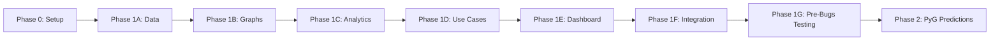
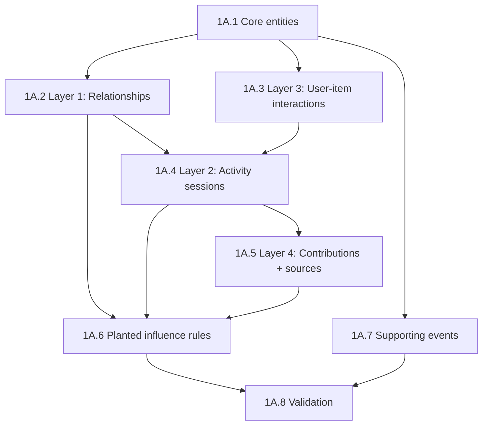

# Implementation Plan — Network Graph Intelligence Project

This document is the step-by-step build guide. It follows `context.md` (what we want) and `architecture.md` (how the pieces fit together).

Each phase includes:
- **What we build**
- **Why it matters** (plain English)
- **Steps** with a clear "done when"
- **Bugs to test** — mapped from `bugs.md`; run these before moving to the next phase
- **Flagged additions** — anything not explicitly in context.md or architecture.md

---

## Overview



| Phase | Goal | Outcome |
|---|---|---|
| **Phase 0** | Project scaffolding | Empty project runs, config loads, folders exist |
| **Phase 1A** | Synthetic data | Realistic fake dataset at target scale, validated |
| **Phase 1B** | Graph building | All 4 graph layers built from data |
| **Phase 1C** | NetworkX analytics | Centrality, communities, paths computed and cached |
| **Phase 1D** | Use case engine | All 8 use cases produce flagged results + explanations |
| **Phase 1E** | Dash dashboard | PM can explore graphs, lists, alerts, and use cases |
| **Phase 1F** | Integration | End-to-end demo works reliably |
| **Phase 1G** | Pre-bugs testing | Common bugs caught from terminal before visual testing |
| **Phase 2** | PyG predictions | Forward-looking predictions added to dashboard |

**In plain English:** We build bottom-up. First the fake data, then turn it into graphs, then analyze it, then turn analysis into product decisions, then show it all in a dashboard. Machine learning comes last, only after everything else works.

---

## Bug-to-phase mapping (master reference)

All 53 bugs from `bugs.md`, mapped to the phase where you first test for them. Phase 1G re-runs the full Phase 1 set (§1–§11) before visual testing.

| Phase | Bug IDs | Count |
|---|---|---|
| **0** | BUG-5.02, BUG-8.01, BUG-11.01, BUG-11.02 (preventive setup) | 4 |
| **1A** | BUG-1.01 – BUG-1.07 | 7 |
| **1B** | BUG-2.01 – BUG-2.06 | 6 |
| **1C** | BUG-3.01 – BUG-3.05 | 5 |
| **1D** | BUG-4.01 – BUG-4.06 | 6 |
| **1E** | BUG-5.01, BUG-5.03 – BUG-5.05, BUG-6.01 – BUG-6.07, BUG-7.01, BUG-7.03 – BUG-7.05 | 15 |
| **1F** | BUG-5.02, BUG-5.06, BUG-7.02, BUG-8.01 – BUG-8.03, BUG-9.01 – BUG-9.03 | 9 |
| **1G** | All Phase 1 bugs (§1–§11) — full regression | 50 |
| **2** | BUG-1.07, BUG-10.01 – BUG-10.03, BUG-11.01 – BUG-11.02 + §1–§11 rerun | 6 |

Details for each bug (what goes wrong, how to test, how to fix) are in `bugs.md`.

---

## Phase 0 — Project setup

**What we build:** Folder structure, dependencies, domain config, and a smoke test that proves the project runs.

**Why it matters:** Everything else depends on a consistent place to put code and config. Doing this first avoids rework later — you don't want to build the generator and then realize there's nowhere sensible to put the config or how to run the project.

### Steps

| Step | Task | Done when |
|---|---|---|
| 0.1 | Create folder structure from architecture.md | All folders and `__init__.py` files exist |
| 0.2 | Create `requirements.txt` with core dependencies | `pip install -r requirements.txt` succeeds |
| 0.3 | Create `domain_config.yaml` with generic defaults + one example domain (e.g. gaming) | Config loads and returns entity name mappings |
| 0.4 | Create `.env` / `.env.example` + `config/env.py` | Secrets and runtime vars load via python-dotenv |
| 0.5 | Create `.gitignore` (data/, caches, `.env`, etc.) | Generated data, caches, and secrets are not tracked |
| 0.6 | Create empty SQLite schema / migration script | `data/synthetic.db` can be created with all table shells |
| 0.7 | Add a `Makefile` or simple run scripts | `run generate`, `run validate`, `run dashboard` are documented |
| 0.8 | Add `scripts/check_env.py` | `.env` validation passes |

**Core dependencies (from architecture.md):**

```
# Data & graphs
networkx
pandas
numpy
pyyaml
python-dotenv

# Dashboard (Phase 1E)
dash
dash-cytoscape
dash-ag-grid  # or dash-table
plotly

# Analytics (Phase 2)
torch
torch-geometric
```

> **Added decision:** Split `requirements.txt` into `requirements.txt` (Phase 1) and `requirements-phase2.txt` (PyG).
>
> **Why:** PyTorch and PyG are heavy installs. Phase 1 shouldn't require them. Keeps the initial dev environment lightweight.

> **Added decision:** Step 0.6 — simple run scripts (`scripts/generate.sh`, etc.) or a Makefile.
>
> **Why:** Architecture defines components but not how to invoke them. One-command workflows reduce friction during iterative development.

### Exit criteria

- Project installs cleanly
- Config file loads
- Empty database can be created
- You can run a no-op smoke test end-to-end

### Bugs to test after this phase

Run these before starting Phase 1A. Full details in `bugs.md`.

| Bug ID | What to check | Why now | Quick test |
|---|---|---|---|
| **BUG-5.02** | Paths work from any working directory | Wrong paths break every later phase silently | `cd /tmp && python /path/to/project/scripts/init_db.py` |
| **BUG-8.01** | Pipeline step order defined in Makefile/scripts | Out-of-order steps cause empty dashboard later | `make help` lists generate → validate → graphs → metrics → dashboard in dependency order |
| **BUG-11.01** | `.env` loads via `config/env.py` | Empty env vars → wrong DB path or port | `python scripts/check_env.py` |
| **BUG-11.02** | `.env` not tracked in git | Accidental commit of local overrides | `git ls-files .env` → empty |

---

## Phase 1A — Synthetic data generation

**What we build:** The full synthetic dataset — all entity tables, all 4 graph layer tables, supporting event tables, and planted influence rules.

**Why it matters:** This is the foundation of everything. If the fake data isn't realistic — no hubs, no clusters, broken timestamps — then graph analysis produces meaningless numbers and the dashboard shows nonsense. Garbage in, garbage out.

Build in dependency order. Each sub-step produces tables the next sub-step needs.



### Step 1A.1 — Core entities (users, items, organizations, sources)

| Task | Detail |
|---|---|
| Generate `organizations` | Enough orgs for within- and cross-org relationships |
| Generate `users` (~10,000) | `join_date` spread over 3-year growth curve; hidden activity propensity (lognormal); assigned to organizations |
| Generate `items` (~1,000) | Hidden popularity score (power-law); genre/category tags |
| Generate `trusted_sources` (~300) | Power-law follower distribution; taste specialization per source |

**Done when:** All four core entity tables populated. Row counts match scale targets. Join dates follow growth curve, not uniform random.

**Why this step matters:** Users, items, and organizations are the "actors" in every graph layer. If they're flat or uniform, nothing downstream will look realistic.

---

### Step 1A.2 — Layer 1: Relationship graph

| Task | Detail |
|---|---|
| Generate `relationship_edges` | Preferential attachment; avg degree 8–20; power-law skew (most users 5–10 connections, hub minority 50–100+) |
| Generate `referrals` | Ground-truth metadata (`referred_by`, `referral_source`); not inferred from timing |
| Enforce timing | `connection_date` ≥ both users' `join_date` |

**Done when:** 80,000–200,000 relationship edges. Degree distribution is visibly skewed (not flat). Referral table populated separately.

**Why this step matters:** The relationship graph is the backbone. Activity sessions, influence propagation, and several use cases (contamination, onboarding, churn) all depend on who is connected to whom.

---

### Step 1A.3 — Layer 3: User–item interactions

| Task | Detail |
|---|---|
| Generate `user_item_interactions` | 15–40 items per user; weighted by item popularity + user taste cluster |
| Support multiple interaction types | Ownership, usage, purchase — mapped via domain config |

**Done when:** 150,000–400,000 interaction rows. A few items are widely owned; many are niche. Users cluster by taste.

**Why this step matters:** User-item data powers recommendations, bundle analysis, and the combined adoption model. It also feeds activity sessions (you co-play games you own).

---

### Step 1A.4 — Layer 2: Shared activity graph

| Task | Detail |
|---|---|
| Generate `activity_sessions` | 20–50 sessions per active user; game/item correlated with participants' taste |
| Generate `activity_session_participants` | 2–8 participants per session |
| Derive `shared_activity_edges` | Aggregate session co-participation into weighted user-user edges |
| Session sourcing | 70–80% from existing relationships; remainder random/matchmade |

**Done when:** 200,000–500,000 sessions. Shared activity graph is related to but distinct from the relationship graph. Edge weights reflect frequency and duration.

**Why this step matters:** Shared activity is often a stronger signal than declared relationships. Several use cases (contamination in sessions, group dependency churn, viral adoption) depend on this layer being realistic and separable from Layer 1.

---

### Step 1A.5 — Layer 4: Contributions and influence graph

| Task | Detail |
|---|---|
| Generate `contributions` | 5–10% of eligible interactions; scaled by user activity propensity; hidden quality score per contribution |
| Generate `contribution_validation_events` | Power-law toward high-quality contributions; preferentially from related users |
| Generate `source_follows` | 3–8 sources per user; power-law source popularity |
| Generate `source_recommendations` | Aligned with source specialization |

**Done when:** All Layer 4 tables populated at target scale. Validation events skew toward quality and network proximity. Sources have realistic follower counts.

**Why this step matters:** This layer powers trusted-contributor detection, research prioritization, fraud ring detection, and source/contributor influence signals for the combined adoption model.

---

### Step 1A.6 — Planted influence rules

| Task | Detail |
|---|---|
| Implement shared rule engine | One engine, five influence families: adoption, participation, activity, source, contributor |
| Define rule parameters | Trigger event, effect boost, decay window, eligible edge types, org constraints |
| Apply rules during generation | Rules modify downstream behavior (e.g. A's purchase raises B's probability) |
| Store in `planted_influence_rules` | Kept separate from data fed to models |

**Done when:** All 5 influence families applied. Rules table populated. Effect sizes are moderate (not trivially detectable, not lost in noise).

**Why this step matters:** Planted rules let us validate that PyG can recover known patterns in Phase 2. They also make the synthetic world behave more like a real network where influence actually spreads.

---

### Step 1A.7 — Supporting event tables

| Task | Detail |
|---|---|
| `community_participation` | For research prioritization use case |
| `support_tickets` / bug reports | For support escalation use case |
| `feature_exposure_log` | For A/B contamination and rollout sequencing |
| `churn_events` | For champion churn risk |
| `onboarding_events` | For onboarding flow decisioning |
| `trust_safety_events` | For fraud detection (optional enrichment) |

**Done when:** All supporting tables populated with realistic volumes. Events respect causal timestamps.

**Why this step matters:** Use cases don't run on graph structure alone — they need experiment assignments, churn records, support tickets, and onboarding events. Without these, the use case engine has nothing to flag.

---

### Step 1A.8 — Data validation

| Task | Detail |
|---|---|
| Timestamp checks | No event before join date; no activity before all participants joined; no contribution before interaction |
| Referential integrity | All foreign keys resolve |
| Distribution checks | Degree distribution skewed; communities exist; hubs present; not flat/uniform |
| Planted rules separable | Rules table exists and is NOT merged into model-facing tables |
| Report output | Pass/fail per check with counts and summary |

**Done when:** Validation script runs and passes all checks. Report is readable.

**Why this step matters:** This is the quality gate. If validation fails, fix the generator before moving on. Building graphs on bad data wastes time.

> **Added decision:** Step 1A.8 includes a **distribution snapshot** — print degree histogram, community count, and top-10 hub users as a sanity check.
>
> **Why:** Row counts alone don't prove the data is realistic. A quick visual/text summary catches flat distributions early.

### Phase 1A exit criteria

- All tables populated at target scale
- Validation passes
- Distribution snapshot looks realistic (hubs, clusters, skew)
- `planted_influence_rules` stored separately
- Data generation is reproducible (seeded random)

### Bugs to test after this phase

Run before Phase 1B. If any fail, fix the generator — do not build graphs on bad data.

| Bug ID | What to check | Why you should care | Quick test |
|---|---|---|---|
| **BUG-1.01** | No empty required tables | Empty tables → blank use cases that look like UI bugs | `validator --check row_counts` |
| **BUG-1.02** | Degree distribution skewed; communities exist | Flat data → "everyone equally important" demo | `validator --check distribution` |
| **BUG-1.03** | Zero timestamp violations | Impossible timelines destroy trust | `validator --check timestamps` |
| **BUG-1.04** | All foreign keys resolve | Dropped edges → wrong graph size | SQL LEFT JOIN orphan check |
| **BUG-1.05** | No duplicate undirected edges | Inflated strength → false contamination alerts | SQL GROUP BY HAVING COUNT(*) > 1 |
| **BUG-1.06** | `config_hash` in DB matches current config | Label/data mismatch after config edits | Compare hash in `dataset_metadata` |
| **BUG-1.07** | `_gen_*` columns not in any export path | Leaked columns invalidate Phase 2 eval | `audit_feature_columns.py` (should pass vacuously) |

---

## Phase 1B — Graph building

**What we build:** Code that reads the SQLite tables and builds in-memory NetworkX graph objects for all 4 layers, plus derived projections.

**Why it matters:** The database stores flat rows. Graph analysis needs connected structures — nodes linked by edges. This step is the bridge between "data in tables" and "analysis on graphs."

### Steps

| Step | Task | Done when |
|---|---|---|
| 1B.1 | Build Layer 1 graph (users + relationship edges) | Graph loads; node/edge counts match DB |
| 1B.2 | Build Layer 2 graph (users + shared activity edges, weighted) | Graph loads; weights reflect frequency/duration |
| 1B.3 | Build Layer 3 bipartite graph (users + items + interaction edges) | Bipartite structure correct; user and item nodes separable |
| 1B.4 | Build Layer 4 graph (users + sources + contributions + validation/follow edges) | Multi-type nodes and edges handled |
| 1B.5 | Build derived projections | Item-item and user-user projections from Layer 3 |
| 1B.6 | Ego network extractor | Given a node ID + radius, return a subgraph (for dashboard) |
| 1B.7 | Cache graphs to disk | Graphs saved as pickles in `data/graphs/`; reload is faster than rebuild |

**Why each layer is built separately:** Each layer answers different questions. Layer 1 is "who knows whom." Layer 2 is "who does things together." Layer 3 is "who uses what." Layer 4 is "who influences whom." Keeping them separate lets the dashboard toggle layers and lets use cases pick the right graph.

> **Added decision:** Step 1B.7 — graph caching with pickle files.
>
> **Why:** From architecture.md. Rebuilding graphs from SQLite on every dashboard load is slow. Cache after first build.

> **Added decision:** Step 1B.6 — ego network extractor as a standalone utility, not embedded in the dashboard.
>
> **Why:** Multiple components need subgraphs (use cases, dashboard graph view, explainability panel). One shared utility avoids duplication.

### Phase 1B exit criteria

- All 4 layer graphs build without errors
- Projections compute correctly
- Ego network extractor returns subgraphs of expected size
- Cached graphs reload correctly
- Basic unit tests pass (node counts, edge counts, known node exists)

### Bugs to test after this phase

Run before Phase 1C.

| Bug ID | What to check | Why you should care | Quick test |
|---|---|---|---|
| **BUG-2.01** | All 4 layer pickle files exist; build exits 0 | Partial build → some use cases work, others empty | `ls data/graphs/layer*.gpickle` |
| **BUG-2.02** | Graph node count = DB user count (isolates kept) | Orphan users vanish from onboarding use case | `G.number_of_nodes() == COUNT(users)` |
| **BUG-2.03** | Layer 2 edge weights vary (not all 1) | Weak vs strong contamination indistinguishable | `max(weight) > min(weight)` on L2 |
| **BUG-2.04** | Layer 4 nodes have `node_type` attribute | PM can't interpret mixed graph | Assert types: user, source, contribution |
| **BUG-2.05** | Ego network capped at config limit (50) | Hub click freezes browser | `extract_ego(hub).nodes <= 50` |
| **BUG-2.06** | Graph cache mtime ≥ DB mtime | Stale graph after regenerate | `check_cache_freshness.py` |

---

## Phase 1C — NetworkX analytics

**What we build:** Compute structural metrics on all graph layers and cache the results.

**Why it matters:** This is the "explain why" engine. Raw graphs are unusable for product decisions — you need scores like "this user bridges 3 teams" or "this cluster is isolated." These scores feed the use case engine and the dashboard.

### Steps

| Step | Task | Layers | Done when |
|---|---|---|---|
| 1C.1 | Degree + edge weight stats | All | Per-node degree stored |
| 1C.2 | Betweenness centrality | 1, 2, 4 | Scores cached per node |
| 1C.3 | Eigenvector centrality | 1, 2, 4 | Scores cached per node |
| 1C.4 | Community detection (Louvain) | All | Community ID per node; cluster summaries |
| 1C.5 | Shortest path / connectivity | 1, 2 | Path lengths between node pairs available |
| 1C.6 | Density + reciprocity | 1, 4 | Per-cluster density/reciprocity scores |
| 1C.7 | Co-occurrence projection metrics | 3 | Item-item similarity scores; user-user taste overlap |
| 1C.8 | Community-validated influence score | 4 | Per-user score based on validation from connected nodes |
| 1C.9 | Connection strength / influence strength | 1, 2 | Composite edge strength for contamination detection |
| 1C.10 | Cache all metrics | All | Metrics saved to `data/metrics/`; reload without recomputing |

**Why this step matters:** Every use case in Phase 1D reads from these cached metrics. If centrality or community detection is wrong or missing, use cases produce empty or incorrect results.

> **Added decision:** Step 1C.8 — community-validated influence as a precomputed metric, not computed on the fly in the use case module.
>
> **Why:** This score requires traversing validation events across the graph. Precomputing it once keeps the use case module simple and the dashboard fast.

> **Added decision:** Step 1C.10 — save metrics as parquet/CSV files in `data/metrics/`, not just in memory.
>
> **Why:** Betweenness on 10k nodes takes minutes. Computing it once and reloading from disk makes iteration on use cases and dashboard much faster.

### Phase 1C exit criteria

- All metrics computed for all layers
- Results cached and reloadable
- Spot-check: top betweenness node is a plausible bridge user
- Spot-check: communities are non-trivial (not 1 giant cluster or 10k singletons)
- Unit tests pass for known small graphs with hand-calculated expected values

### Bugs to test after this phase

Run before Phase 1D.

| Bug ID | What to check | Why you should care | Quick test |
|---|---|---|---|
| **BUG-3.01** | No betweenness/centrality compute in `dashboard/` | Dashboard hangs minutes on load | `grep betweenness dashboard/` → no compute calls |
| **BUG-3.02** | No all-zero or NaN metric columns | Rollout/churn lists blank | `assert metrics.std() > 0; notna().all()` |
| **BUG-3.03** | Each use case reads documented graph layer | Wrong layer → wrong user flagged | Unit test per use case `required_layers` |
| **BUG-3.04** | Same seed → same community IDs | Cluster drill-down wrong after rebuild | Diff community file across two seeded runs |
| **BUG-3.05** | Every user has a metric row (including isolates) | Orphan click → blank panel | LEFT JOIN users to node_metrics → 0 nulls |

---

## Phase 1D — Use case engine

**What we build:** Eight modules that turn cached metrics into product decisions — flagged lists, explanations, and recommended actions.

**Why it matters:** Metrics alone don't help a PM. "Eigenvector centrality 0.82" means nothing to most people. Use cases translate numbers into "this user is a super-connector — prioritize for retention" or "this A/B test is contaminated — exclude these 4 users."

Build one use case at a time. Each is independently testable.

### Build order (recommended)

Start with the simplest (binary/exempt toggles), then structural rankings, then composite scores:

| Order | Use case | Complexity | Why this order |
|---|---|---|---|
| 1 | Onboarding flow (#6) | Low — binary check | Simplest; validates the use case interface works |
| 2 | Feature discovery gap (#7) | Low — distance metric | Tests cluster/exposure logic |
| 3 | Fraud ring detection (#8) | Medium — pattern detection | Tests density/reciprocity on communities |
| 4 | Feature rollout sequencing (#3) | Medium — eigenvector ranking | First ranked list with toggle |
| 5 | Support escalation (#5) | Medium — betweenness ranking | Similar pattern, different metric |
| 6 | A/B contamination (#1) | Medium-high — composite score | Combines connection + influence strength |
| 7 | Champion churn risk (#2) | Medium-high — composite score | Combines eigenvector + activity signal |
| 8 | User research prioritization (#4) | High — community-validated influence | Most complex metric; build last |

> **Added decision:** Recommended build order within Phase 1D (simplest → most complex).
>
> **Why:** Architecture says "one module per use case" but doesn't specify order. Building simplest first validates the shared interface early and catches problems before tackling composite scores.

### Per use case — what each module must produce

Every module implements the same interface:

```
Input:  graph layer(s) + cached metrics + supporting event tables
Output: {
    flagged_nodes or flagged_clusters,
    metric_values,
    plain_language_explanation,
    recommended_action,
    ego_network or subgraph reference
}
```

| # | Use case | Key logic | Toggle? |
|---|---|---|---|
| 1 | A/B contamination | Find experiment pairs where test/control users are connected above strength threshold | Most/least |
| 2 | Champion churn risk | Rank by eigenvector centrality × activity signal | Most/least |
| 3 | Feature rollout sequencing | Rank by eigenvector centrality | Most/least |
| 4 | User research prioritization | Rank by community-validated influence | Most/least |
| 5 | Support escalation | Rank open tickets by user's betweenness centrality | Most/least |
| 6 | Onboarding flow | Binary: new user has existing connection → self-serve; no connection → guided | Exempt |
| 7 | Feature discovery gap | Find clusters with high distance from feature exposure nodes | Exempt |
| 8 | Fraud ring detection | Flag clusters with high density + reciprocity above threshold | Exempt |

**Why build one at a time:** Each use case has different metrics, toggle rules, and explanation templates. Building and testing them individually means a bug in fraud detection doesn't block rollout sequencing.

### Phase 1D exit criteria

- All 8 use cases produce output
- Each output includes explanation + recommended action
- Ranked use cases support most/least-important toggle
- Exempt use cases (6, 7, 8) work without toggle
- Unit tests pass per use case with known inputs

### Bugs to test after this phase

Run before Phase 1E. Test each use case module in isolation — no dashboard needed.

| Bug ID | What to check | Why you should care | Quick test |
|---|---|---|---|
| **BUG-4.01** | Empty result includes `empty_message` | Blank screen indistinguishable from broken | `assert result.empty_message if not flagged` |
| **BUG-4.02** | Explanations are plain English | PM can't act on jargon | No raw metric names alone in explanation |
| **BUG-4.03** | Onboarding uses **active** connections only | Dead connection → wrong self-serve path | Fixture: edge to inactive user → `guided` |
| **BUG-4.04** | Churned users excluded from churn risk list | "Retain user who already left" | `churned_ids ∩ flagged_ids == ∅` |
| **BUG-4.05** | A/B alerts tiered by connection strength | Alert fatigue on weak pairs | Strong pair level > weak pair level |
| **BUG-4.06** | Research priority uses validated influence, not degree | Use case #4 redundant with #3 | High-degree/zero-validation ranks low |

---

## Phase 1E — Dash dashboard

**What we build:** The PM-facing web app — graph views, ranked lists, search, alerts, use case section, and explainability panel.

**Why it matters:** Everything built so far lives in Python scripts and cached files. The dashboard is what makes the project a demo someone can actually open and use. Without it, the work is invisible.

Build incrementally: layout first, then one entry path at a time, then wire callbacks.

### Steps

| Step | Task | Done when |
|---|---|---|
| 1E.1 | Dash app skeleton + layout | App starts; empty page with section placeholders |
| 1E.2 | Layer selector | Dropdown toggles which graph layer(s) are active |
| 1E.3 | Ranked list entry path | Sortable table of nodes by centrality; row click triggers callback |
| 1E.4 | Cytoscape graph view | Ego network renders for selected node; node click triggers callback |
| 1E.5 | Explainability panel | Shows metric, edges, explanation, and recommended action for selected node |
| 1E.6 | Wire list → graph → explanation callbacks | Click row in list → graph updates → explanation updates |
| 1E.7 | Search/lookup entry path | Search by user/item/org/source → jump to ego network |
| 1E.8 | Alert-driven entry path | Flagged nodes from use cases appear as clickable alerts |
| 1E.9 | Cluster drill-down entry path | Community bubbles → cluster → top nodes → ego network |
| 1E.10 | Use case section | All 8 use cases rendered with most/least toggle where applicable |
| 1E.11 | Layer 3 table views | Recommendations, similarity scores, bundle suggestions as tables below graph |
| 1E.12 | Wire use case → graph → explanation callbacks | Click use case result → graph and explanation update |

**Why build in this order:** Layout and one entry path (ranked list → graph → explanation) prove the core loop works. Then add the other three entry paths. Then the use case section. Each step adds one interaction pattern without breaking what's already working.

> **Added decision:** Step 1E.1 starts with a static layout and placeholder components before wiring any data.
>
> **Why:** Dash callback debugging is easier when the layout is stable. Get the page structure right first, then connect data.

> **Added decision:** Step 1E.6 is an explicit milestone — "core loop works" — before building the other entry paths.
>
> **Why:** The list → graph → explanation loop is the most important interaction. Proving it works early de-risks the rest of the dashboard.

### Phase 1E exit criteria

- Dashboard starts with `python dashboard/app.py` (or run script)
- All 4 entry paths work
- Layer selector toggles graph layers
- Use case section shows all 8 with correct toggles
- Clicking anything updates the right panels
- No full 10k-node graph rendered at any point
- Layer 3 outputs appear as tables, not forced into graph

### Bugs to test after this phase

Run before Phase 1F. Most of these can be tested with `pytest tests/test_dashboard_callbacks.py` and curl — minimal browser time.

| Bug ID | What to check | Why you should care | Quick test |
|---|---|---|---|
| **BUG-5.01** | Startup shows message if DB missing | Blank page on first install | Run dashboard without `synthetic.db` |
| **BUG-5.03** | Callback output IDs match layout IDs | Click does nothing | Assert all callback outputs exist in layout |
| **BUG-5.04** | Cytoscape elements have correct shape | Graph blank despite 200 OK | Unit test `build_cytoscape_elements()` schema |
| **BUG-5.05** | `dcc.Store('selected-node')` persists across tabs | Context lost on tab switch | Callback test: select → switch tab → same ID |
| **BUG-6.01** | Page HTML non-empty on load | White screen | `curl localhost:8050 \| wc -c` >> 500 |
| **BUG-6.02** | Cytoscape div has explicit height | Graph invisible (CSS) | Layout style height ≥ 600px |
| **BUG-6.03** | Table column `field` names match row keys | Headers only, no rows | Assert column fields ⊆ row keys |
| **BUG-6.04** | Layer 3 shows table, hides graph | Unreadable bipartite spaghetti | Layer selector callback test |
| **BUG-6.05** | No importance toggle on use cases 6, 7, 8 | Broken UI control | Assert toggle absent for exempt cases |
| **BUG-6.06** | Hub ego view shows "Showing N of M" | PM thinks hub has only 50 connections | Caption in graph view metadata |
| **BUG-6.07** | Orphan click shows message, not blank | Looks broken | `assert 'no connections' in empty state` |
| **BUG-7.01** | Row click passes `user_id`, not row index | Graph shows wrong user | Callback test with known ID |
| **BUG-7.03** | Scores shown with rank/percentile context | Raw 0.0045 meaningless | Explainability includes "top X%" |
| **BUG-7.04** | Search case-insensitive on display_name | Name search fails | `search(name.lower())` returns result |
| **BUG-7.05** | Header count matches table row count | Trust in flagged counts | `len(flagged) == header_count` |

## Phase 1F — Integration and demo readiness

**What we build:** End-to-end pipeline, documentation, and a clean demo path.

**Why it matters:** Individual components working in isolation doesn't mean the full system works together. Integration catches mismatches — wrong column names between generator and graph builder, missing metrics that use cases expect, dashboard callbacks pointing to stale data.

### Steps

| Step | Task | Done when |
|---|---|---|
| 1F.1 | End-to-end pipeline script | One command: generate → validate → build graphs → compute metrics → start dashboard |
| 1F.2 | Fresh-run test | Delete all data, run pipeline from scratch, dashboard works |
| 1F.3 | Spot-check all 8 use cases in dashboard | Each use case shows plausible results with explanations |
| 1F.4 | Spot-check all 4 entry paths | Each path navigates correctly |
| 1F.5 | Performance check | Dashboard loads in under 5 seconds; no live centrality computation |
| 1F.6 | README with setup and run instructions | Someone else can clone, install, generate, and open dashboard |

> **Added decision:** Phase 1F as a dedicated integration phase.
>
> **Why:** Architecture defines components but not an explicit integration checkpoint. A dedicated step catches "works in pieces, breaks together" problems before calling Phase 1 done.

> **Added decision:** Step 1F.5 — performance check with a 5-second load target.
>
> **Why:** Architecture mentions precomputed caching to avoid slow loads but doesn't set a target. Five seconds is a reasonable prototype bar.

### Phase 1F exit criteria

- Full pipeline runs from empty to working dashboard
- All 8 use cases show results with explanations
- All 4 entry paths work
- Dashboard loads quickly (cached metrics, no live computation)
- README documents how to run everything

### Bugs to test after this phase

Run before Phase 1G. These are integration and performance bugs — components work alone but break together.

| Bug ID | What to check | Why you should care | Quick test |
|---|---|---|---|
| **BUG-5.02** | Pipeline works from different cwd | "Works on my machine" | `cd /tmp && make -C /path/to/project pipeline` |
| **BUG-5.06** | No SQLite lock errors under normal use | Intermittent demo failures | Document: stop dashboard before regenerate |
| **BUG-7.02** | Metrics mtime ≥ DB mtime after fresh pipeline | Rankings from old run | `check_cache_freshness.py` |
| **BUG-8.01** | Pipeline steps run in correct order | Zeros in dashboard despite green steps | Log grep: generate → validate → graphs → metrics |
| **BUG-8.02** | Failed pipeline doesn't leave dirty partial state | "Worked yesterday" heisenbugs | Fail mid-pipeline → rerun → clean or clear error |
| **BUG-8.03** | Integration test exists and passes | Unit mocks hide wiring bugs | `pytest -m integration` |
| **BUG-9.01** | Dashboard startup < 5 seconds | PM closes slow tab | `time curl localhost:8050` |
| **BUG-9.02** | Callback response < 1 second | UI feels frozen | Dash testing timer on row click |
| **BUG-9.03** | Memory RSS reasonable on graph load | Process killed silently on laptop | `/usr/bin/time -v load_graphs()` < 2GB |
| **BUG-11.01** | `.env` loads via `config/env.py` | Wrong DB path or port | `python scripts/check_env.py` |
| **BUG-11.02** | `.env` not tracked in git | Local config leaks into repo | `git ls-files .env` → empty |

---

## Phase 1G — Pre-bugs testing

**What we build:** No new features. Run the full automated bug checklist from `bugs.md` and fix every failure before opening the dashboard for visual testing.

**Why it matters:** Past experience shows the same bugs surface repeatedly — empty data, stale caches, broken callbacks, tables with wrong columns — and they look like "front-end bugs" when you test with your eyes. Most are detectable from the terminal in minutes.

**Why you should care:** Visual testing is slow and frustrating when the underlying data or wiring is wrong. You click around for an hour debugging a blank graph when the real problem was an empty `feature_exposure_log` table. Pre-bugs testing catches that in 10 seconds.

**Prerequisite:** Phase 1F passes (full pipeline runs end-to-end).

**Do not start manual spot-checks from `evals.md` until Phase 1G passes.**

### Steps

| Step | Task | Bugs covered |
|---|---|---|
| 1G.1 | Run data bug checks (bugs.md §1) | BUG-1.01 – BUG-1.07 |
| 1G.2 | Run graph bug checks (bugs.md §2) | BUG-2.01 – BUG-2.06 |
| 1G.3 | Run metrics bug checks (bugs.md §3) | BUG-3.01 – BUG-3.05 |
| 1G.4 | Run use case bug checks (bugs.md §4) | BUG-4.01 – BUG-4.06 |
| 1G.5 | Run backend ↔ frontend checks (bugs.md §5) | BUG-5.01 – BUG-5.06 |
| 1G.6 | Run rendering checks (bugs.md §6) | BUG-6.01 – BUG-6.07 |
| 1G.7 | Run data rendering checks (bugs.md §7) | BUG-7.01 – BUG-7.05 |
| 1G.8 | Run pipeline checks (bugs.md §8) | BUG-8.01 – BUG-8.03 |
| 1G.9 | Run performance smoke (bugs.md §9) | BUG-9.01 – BUG-9.03 |
| 1G.10 | Run environment / `.env` checks (bugs.md §11) | BUG-11.01 – BUG-11.02 |
| 1G.11 | Fix all failures | All above |

### How to run

```bash
# Full pre-bugs runbook (from bugs.md §12)
python validator/run_validation.py --all
python scripts/check_cache_freshness.py --pre
python graphs/builder.py --all-layers
pytest tests/test_graphs.py tests/test_use_cases.py -q
pytest tests/test_dashboard_callbacks.py -q
python scripts/audit_feature_columns.py
python scripts/check_env.py
pytest tests/ -m integration -q
python scripts/perf_smoke.py
```

> **Added decision:** Phase 1G as a dedicated gate before visual testing.
>
> **Why:** Based on prior testing experience — separates automated bug hunting from evals.md manual spot-checks.

> **Added decision:** Helper scripts `check_cache_freshness.py`, `audit_feature_columns.py`, `perf_smoke.py`.
>
> **Why:** bugs.md references these for repeatable pre-visual checks.

### Pass criteria

- All commands in runbook exit 0
- No CRITICAL or HIGH severity bugs from `bugs.md` §12 remain open

### Fail criteria

- Any validator or pytest failure
- Stale cache detected
- Callback ID mismatch
- Empty required tables
- Metrics NaN or constant
- Dashboard imports betweenness/GNN compute paths

### What success looks like

You run the runbook, everything is green, and you feel confident opening the browser. Visual testing from `evals.md` becomes confirmation of good UX — not archaeology for silent data bugs.

**After Phase 1G passes → proceed to evals.md manual spot-checks → Phase 1 is demo-ready.**

---

## Phase 2 — PyG predictions

**What we build:** Graph neural network models that predict future outcomes — adoption, churn cascades, influence propagation — and integrate them into the dashboard.

**Why it matters:** Phase 1 tells you what the graph looks like today. Phase 2 tells you what might happen tomorrow. This is the difference between "this user is important" and "if this user leaves, these 12 others are likely to follow." It also validates that the planted influence rules can be recovered by ML — proving the mechanism works.

**Prerequisite:** Phase 1G fully complete (pre-bugs testing passed + evals.md manual spot-checks done). Do not start Phase 2 until the descriptive layer is solid and visually verified.

### Steps

| Step | Task | Done when |
|---|---|---|
| 2.1 | NetworkX → PyG graph conversion | All 4 layers export to PyG `Data` objects with node features and edge indices |
| 2.2 | Train/val/test split | Split respects graph structure (no leakage across splits) |
| 2.3 | Combined adoption model | Single model using social + activity + item + influence signals; predicts user-item adoption |
| 2.4 | Churn cascade model | GNN predicts which nodes are at risk when a champion node churns |
| 2.5 | Influence propagation model | GNN simulates spread after a trigger event (adoption, participation, activity) |
| 2.6 | Influence recovery validation | Models recover planted rules from `planted_influence_rules` without being given them as input |
| 2.7 | Cache model predictions | Predictions saved to `data/models/`; dashboard reads cached predictions, not live inference |
| 2.8 | Dashboard integration | Explainability panel shows prediction + confidence; use cases 2 and 3 gain forward-looking scores |
| 2.9 | Phase 2 integration test | Full pipeline including model training and dashboard predictions |

**Why each step matters:**

- **2.1–2.2:** PyG needs a specific graph format and honest train/test splits. Bad splits = inflated accuracy.
- **2.3:** One combined model, not five separate ones. Context explicitly says to fold social, activity, item, and influence signals together.
- **2.4–2.5:** These are the "what will happen" predictions that differentiate the project from a static dashboard.
- **2.6:** This is the proof that the system works — models find the influence patterns we planted, without being told where they are.
- **2.7–2.8:** Predictions must appear in the dashboard with confidence scores, or Phase 2 has no visible impact.

> **Added decision:** Step 2.7 — cache predictions to disk, don't run live GNN inference on dashboard load.
>
> **Why:** Same reasoning as metric caching in Phase 1C. GNN inference on 10k nodes is too slow for interactive use.

> **Added decision:** Step 2.2 — explicit train/val/test split step with graph-aware splitting.
>
> **Why:** Context doesn't mention ML splitting strategy. Random splits leak neighbors across sets and inflate GNN accuracy. Must be called out explicitly.

> **Added decision:** `requirements-phase2.txt` for PyTorch + PyG (introduced in Phase 0).
>
> **Why:** Keeps Phase 1 environment lightweight. Phase 2 adds heavy deps only when needed.

### Phase 2 exit criteria — Project complete

- Combined adoption model trained and evaluated
- Churn cascade and influence propagation models produce predictions
- Models recover planted influence rules above baseline
- Dashboard shows predictions with confidence in explainability panel
- Use cases 2 (churn) and 3 (rollout) include forward-looking scores
- Full pipeline (generate → validate → graphs → metrics → train → dashboard) runs end-to-end

### Bugs to test after this phase

Run after Phase 2 integration. Then re-run Phase 1G runbook including §10.

| Bug ID | What to check | Why you should care | Quick test |
|---|---|---|---|
| **BUG-1.07** | `_gen_*` / planted rules not in PyG features | Model gets answer key | `audit_feature_columns.py --phase2` |
| **BUG-10.01** | Planted rules absent from feature matrix | Influence recovery is fake | Feature allowlist audit |
| **BUG-10.02** | Graph-aware train/test split | Inflated accuracy misleads demo | No cross-split edges test |
| **BUG-10.03** | No live GNN inference in dashboard callbacks | 30s hang on click | `grep predict dashboard/` → empty |

Also re-run **Phase 1G full runbook** (including `check_env.py`) after Phase 2 dashboard integration.

---

## Summary — all flagged additions

Decisions in this document that go beyond context.md and architecture.md:

| # | Addition | Where | Why |
|---|---|---|---|
| 1 | Split requirements into Phase 1 and Phase 2 files | Phase 0 | PyTorch/PyG are heavy; don't block Phase 1 setup |
| 2 | Run scripts / Makefile | Phase 0 | One-command workflows for generate, validate, dashboard |
| 3 | Distribution snapshot in validation | Phase 1A.8 | Row counts alone don't prove realistic shape |
| 4 | Ego network extractor as shared utility | Phase 1B | Used by use cases, dashboard, and explainability — build once |
| 5 | Community-validated influence as precomputed metric | Phase 1C | Complex score; compute once, not per use case call |
| 6 | Metrics saved as parquet/CSV files | Phase 1C | Avoid recomputing betweenness on every iteration |
| 7 | Use case build order (simple → complex) | Phase 1D | Validate shared interface early; tackle hard cases last |
| 8 | Dashboard: static layout before wiring data | Phase 1E | Stable layout makes callback debugging easier |
| 9 | Dashboard: "core loop" milestone before other entry paths | Phase 1E | Prove list → graph → explanation works before adding complexity |
| 10 | Dedicated integration phase (1F) | Phase 1F | Catch "works in pieces, breaks together" problems |
| 11 | 5-second dashboard load target | Phase 1F | Concrete performance bar for prototype |
| 12 | Graph-aware train/val/test split | Phase 2 | Prevent neighbor leakage inflating GNN accuracy |
| 13 | Cache GNN predictions to disk | Phase 2 | Same reasoning as metric caching — no live inference on load |
| 14 | Phase 1G pre-bugs testing gate | Phase 1G | Catch common bugs from terminal before visual testing |
| 15 | Helper scripts for pre-bugs runbook | Phase 1G | `check_cache_freshness`, `audit_feature_columns`, `perf_smoke`, `check_env` |
| 16 | `.env` + `config/env.py` + `.env.example` | Phase 0 | Local runtime config; BUG-11.xx |

---

## What to build first (quick reference)

If you want the shortest path to something visible:

```
Phase 0  →  1A.1–1A.2  →  1A.8  →  1B.1  →  1C.2–1C.3  →  1D (#6 onboarding)  →  1E.1–1E.6  →  1F  →  1G  →  evals spot-check  →  demo!
```

That gives you: config, users, relationships, validation, one graph, centrality scores, one use case, and a dashboard where you can click a user and see their network. Everything after that adds breadth.

**In plain English:** Build the skeleton first, then flesh it out layer by layer. Don't try to build everything at once.
